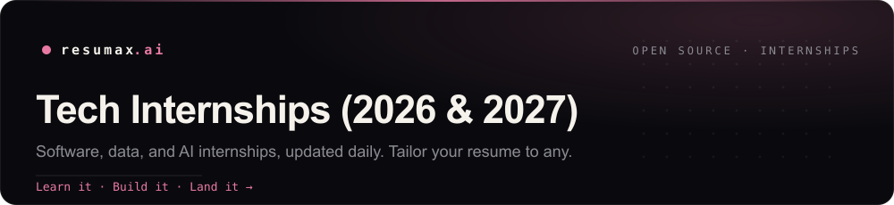

  

# Tech Internships (2026 & 2027)

Open software, data, AI/ML, security, and hardware **internships, co-ops, and working-student roles** for 2026 and 2027, refreshed daily and deduped across job boards. Every listing links into [ResuMax](https://resumax.ai/?utm_source=github&utm_medium=repo&utm_campaign=tech-internships&utm_content=intro), where **Atlas**, our AI career copilot, tailors your resume to it and preps you to ace the interview.

  

### Prepare a truthful, role-specific application.

**[Tailor your resume to any role above &rarr;](https://resumax.ai/?utm_source=github&utm_medium=repo&utm_campaign=tech-internships&utm_content=cta-link)**

Atlas compares the posting with your confirmed experience, prepares reviewable resume suggestions, and builds a focused coding, system-design, and behavioral interview plan. It never invents experience or submits an application for you.

**Found a role we're missing or a dead link?** [Open an issue](../../issues/new) and we'll fold it in.

## Open internships

**468** open, newest first.

🌐 Remote &nbsp;·&nbsp; 🆕 Posted this week

| Company | Role | Location | Apply | Tailor | Age |
|---|---|---|:--:|:--:|--:|
| **[AbbVie](https://resumax.ai/companies/abbvie?utm_source=github&utm_medium=repo&utm_campaign=tech-internships)** 🆕 | Engineering Internship Program (Chemical, Electromechanical,… | Heredia, Heredia Province, cr | [Apply](https://jobs.smartrecruiters.com/abbvie/3743990016519226) |  | 0d |
| **[Bosch Group](https://resumax.ai/companies/bosch-group?utm_source=github&utm_medium=repo&utm_campaign=tech-internships)** 🆕 | [BD] Software Developer Intern (Backend/ JavaScript / APIs /… | Ho Chi Minh, vn | [Apply](https://jobs.smartrecruiters.com/boschgroup/744000158706539) |  | 0d |
| **[Western Digital](https://resumax.ai/companies/western-digital?utm_source=github&utm_medium=repo&utm_campaign=tech-internships)** 🆕 | Internship - Software Development (Embedded) | Petaling Jaya, Selangor, my | [Apply](https://jobs.smartrecruiters.com/westerndigital/744000158684529) |  | 0d |
| **[Fifty-five](https://resumax.ai/companies/fifty-five?utm_source=github&utm_medium=repo&utm_campaign=tech-internships)** 🆕 | Data & AI Engineer Intern (H/F) | Paris, Île-de-France, France | [Apply](https://apply.workable.com/j/6F871CD427/apply) |  | 0d |
| **[Bosch Group](https://resumax.ai/companies/bosch-group?utm_source=github&utm_medium=repo&utm_campaign=tech-internships)** 🆕 | [Internship Program Q1 2027] Embedded Software Engineer Intern… | Ho Chi Minh, vn | [Apply](https://jobs.smartrecruiters.com/boschgroup/744000158674821) |  | 0d |
| **[Western Digital](https://resumax.ai/companies/western-digital?utm_source=github&utm_medium=repo&utm_campaign=tech-internships)** 🆕 | Internship - Data Engineering | Petaling Jaya, Selangor, my | [Apply](https://jobs.smartrecruiters.com/westerndigital/744000158655189) |  | 0d |
| **[Bosch Group](https://resumax.ai/companies/bosch-group?utm_source=github&utm_medium=repo&utm_campaign=tech-internships)** 🆕 | [Internship Program Q1 2027] AI Engineer Intern | Ho Chi Minh, vn | [Apply](https://jobs.smartrecruiters.com/boschgroup/744000158674030) |  | 0d |
| **[Bosch Group](https://resumax.ai/companies/bosch-group?utm_source=github&utm_medium=repo&utm_campaign=tech-internships)** 🆕 | [Internship Program Q1 2027] DevOps Engineer Intern | Ho Chi Minh, vn | [Apply](https://jobs.smartrecruiters.com/boschgroup/744000158675019) |  | 0d |
| **[Bosch Group](https://resumax.ai/companies/bosch-group?utm_source=github&utm_medium=repo&utm_campaign=tech-internships)** 🆕 | [Internship Program Q1 2027] Fullstack Engineer Intern… | Ho Chi Minh, vn | [Apply](https://jobs.smartrecruiters.com/boschgroup/744000158674399) |  | 0d |
| **[Tri](https://resumax.ai/companies/tri?utm_source=github&utm_medium=repo&utm_campaign=tech-internships)** 🆕 | Robotics Intern, Human-Machine Interaction Research | Los Altos, CA | [Apply](https://jobs.lever.co/tri/16336213-1880-482f-87d0-b15fa4141047/apply) |  | 0d |
| **[Clera](https://resumax.ai/companies/clera?utm_source=github&utm_medium=repo&utm_campaign=tech-internships)** 🆕 | Computer Vision & Robotics Intern | San Francisco | [Apply](https://jobs.ashbyhq.com/clera/add0d66a-62ce-43e6-a666-4ee20b2d3bcb/application) |  | 1d |
| **[Talos Trading](https://resumax.ai/companies/talos-trading?utm_source=github&utm_medium=repo&utm_campaign=tech-internships)** 🆕 | Software Engineer Intern, Dealer | New York | [Apply](https://jobs.ashbyhq.com/talos-trading/91fd5274-3b6b-43cf-b366-9f6dc2ae5977/application) |  | 1d |
| **[Bosch Group](https://resumax.ai/companies/bosch-group?utm_source=github&utm_medium=repo&utm_campaign=tech-internships)** 🆕 | Intern, Software Development | Singapore, Singapore, sg | [Apply](https://jobs.smartrecruiters.com/boschgroup/744000158429749) |  | 1d |
| **[Figma](https://resumax.ai/companies/figma?utm_source=github&utm_medium=repo&utm_campaign=tech-internships)** 🆕 | PhD Intern, Security Engineer (2027) | San Francisco, CA • New York, NY | [Apply](https://boards.greenhouse.io/figma/jobs/6238015004?gh_jid=6238015004) |  | 1d |
| **[Syntiant](https://resumax.ai/companies/syntiant?utm_source=github&utm_medium=repo&utm_campaign=tech-internships)** 🆕 | Internship - DevOps Machine Learning Infrastructure | Irvine, California, United States | [Apply](https://apply.workable.com/j/468B53B345/apply) |  | 1d |
| **[Tri](https://resumax.ai/companies/tri?utm_source=github&utm_medium=repo&utm_campaign=tech-internships)** 🆕 | Robotics Intern, Human-Machine Interaction Research | Los Altos, CA | [Apply](https://jobs.lever.co/tri/dcc68e06-e6a6-4cb5-b0a9-282ab9c16dc8/apply) |  | 0d |
| **[Talos Trading](https://resumax.ai/companies/talos-trading?utm_source=github&utm_medium=repo&utm_campaign=tech-internships)** 🆕 | Software Engineer Intern, RFQ | New York | [Apply](https://jobs.ashbyhq.com/talos-trading/2c833180-484f-4657-80e3-f822cf1a0285/application) |  | 1d |
| **[LinkedIn](https://resumax.ai/companies/linkedin?utm_source=github&utm_medium=repo&utm_campaign=tech-internships)** 🆕 | Software Engineer Intern (First Play)  - Summer 2027 (Mountain… | Mountain View, CA, us | [Apply](https://jobs.smartrecruiters.com/linkedin3/744000158394370) |  | 1d |
| **[SharkNinja](https://resumax.ai/companies/sharkninja?utm_source=github&utm_medium=repo&utm_campaign=tech-internships)** 🆕 | Spring 2027: Product Design Engineering Co-op, Advanced… | Needham, MA, United States | [Apply](https://job-boards.greenhouse.io/sharkninjaoperatingllc/jobs/4720191006) |  | 2d |
| **[Bosch Group](https://resumax.ai/companies/bosch-group?utm_source=github&utm_medium=repo&utm_campaign=tech-internships)** 🆕 | AI Engineering Automation Intern (f/m/div.) | São João, Aveiro, pt | [Apply](https://jobs.smartrecruiters.com/boschgroup/744000158348849) |  | 2d |
| **[Renesas Electronics](https://resumax.ai/companies/renesas-electronics?utm_source=github&utm_medium=repo&utm_campaign=tech-internships)** 🆕 | Application Engineer Intern | San Jose, CALIFORNIA, us | [Apply](https://jobs.smartrecruiters.com/renesaselectronics/744000158346447) |  | 2d |
| **[Sopra Steria](https://resumax.ai/companies/sopra-steria?utm_source=github&utm_medium=repo&utm_campaign=tech-internships)** 🆕 | Werkstudent:in AI und Softwareentwicklung im PLM-Umfeld (m/w/d) | Hamburg, HH, de | [Apply](https://jobs.smartrecruiters.com/soprasteria1/744000158334959) |  | 2d |
| **[Intuitive](https://resumax.ai/companies/intuitive?utm_source=github&utm_medium=repo&utm_campaign=tech-internships)** 🆕 | Manufacturing Software Engineering Intern | Sunnyvale, CA, us | [Apply](https://jobs.smartrecruiters.com/intuitive/744000158313919) |  | 2d |
| **[Wabtec](https://resumax.ai/companies/wabtec?utm_source=github&utm_medium=repo&utm_campaign=tech-internships)** 🆕 | Wabtec Spring 2027 Software Engineering Co-Op (10-Week) | Schenectady, NY, us | [Apply](https://jobs.smartrecruiters.com/wabtec/3743990016452226) |  | 2d |
| **[Infleqtion](https://resumax.ai/companies/infleqtion?utm_source=github&utm_medium=repo&utm_campaign=tech-internships)** 🆕 | Summer 2027 Internship - Quantum Software (QSW) | Chicago, Illinois, United States | [Apply](https://apply.workable.com/j/EB77DE8198/apply) |  | 2d |
| **[Javelin Global Commodities](https://resumax.ai/companies/javelin-global-commodities?utm_source=github&utm_medium=repo&utm_campaign=tech-internships)** 🆕 | Summer Intern: Software Engineering | London, England, United Kingdom | [Apply](https://apply.workable.com/j/CAF64E75BF/apply) |  | 2d |
| **[Bosch Group](https://resumax.ai/companies/bosch-group?utm_source=github&utm_medium=repo&utm_campaign=tech-internships)** 🆕 | [SX/BSV-VN] Embedded Test Engineer Intern | Ha Noi, vn | [Apply](https://jobs.smartrecruiters.com/boschgroup/744000158244934) |  | 2d |
| **[Intuitive](https://resumax.ai/companies/intuitive?utm_source=github&utm_medium=repo&utm_campaign=tech-internships)** 🆕 | Robotics Engineering Intern | Sunnyvale, CA, us | [Apply](https://jobs.smartrecruiters.com/intuitive/744000158313717) |  | 2d |
| **[Mercor](https://resumax.ai/companies/mercor?utm_source=github&utm_medium=repo&utm_campaign=tech-internships)** 🆕 | Research Engineer, Intern – Benchmarking | San Francisco | [Apply](https://jobs.ashbyhq.com/mercor/2b1a4fd9-300d-4ae9-b5c8-eacba99bf4ae/application) |  | 2d |
| **[Sia](https://resumax.ai/companies/sia?utm_source=github&utm_medium=repo&utm_campaign=tech-internships)** 🆕 | Final year internship - Marketing Data Scientist | Paris, IDF, fr | [Apply](https://jobs.smartrecruiters.com/sia/744000158085109) |  | 3d |
| **[Resurgent Industries](https://resumax.ai/companies/resurgent-industries?utm_source=github&utm_medium=repo&utm_campaign=tech-internships)** 🆕 | Embedded Firmware and Controls Engineer (Entry-Level / Intern) | Austin | [Apply](https://jobs.ashbyhq.com/resurgent-industries/cf80a6e9-02db-4f0b-88cf-6bebd61fd3bf/application) |  | 3d |
| **[Bosch Group](https://resumax.ai/companies/bosch-group?utm_source=github&utm_medium=repo&utm_campaign=tech-internships)** 🆕 | [BD] JavaScript Developer Intern (6-month fulltime internship) | Ho Chi Minh, vn | [Apply](https://jobs.smartrecruiters.com/boschgroup/744000157957589) |  | 3d |
| **[Experian](https://resumax.ai/companies/experian?utm_source=github&utm_medium=repo&utm_campaign=tech-internships)** 🆕 | Software Engineering Intern | Cyberjaya, Selangor, my | [Apply](https://jobs.smartrecruiters.com/Experian/744000157956149) |  | 3d |
| **[Saviynt](https://resumax.ai/companies/saviynt?utm_source=github&utm_medium=repo&utm_campaign=tech-internships)** 🆕 | Research Scientist Intern - PhD | Milpitas, California | [Apply](https://jobs.lever.co/saviynt/183188c3-c043-4f91-b3f0-30ec4961f4c7/apply) |  | 3d |
| **[Mercor](https://resumax.ai/companies/mercor?utm_source=github&utm_medium=repo&utm_campaign=tech-internships)** 🆕 | Research Engineer Intern - Environments, Data and Post-Training | San Francisco | [Apply](https://jobs.ashbyhq.com/mercor/049bd532-6fb7-4ae6-85a1-788dd31a14ca/application) |  | 2d |
| **[Tri](https://resumax.ai/companies/tri?utm_source=github&utm_medium=repo&utm_campaign=tech-internships)** 🆕 | Robotics Intern, Trustworthy Learning under Uncertainty | Los Altos, CA | [Apply](https://jobs.lever.co/tri/6f60ff79-c902-466a-912c-7ab849ce6424/apply) |  | 3d |
| **[Bosch Group](https://resumax.ai/companies/bosch-group?utm_source=github&utm_medium=repo&utm_campaign=tech-internships)** 🆕 | Mechanical Design Engineering Intern | Fort Lauderdale, FL, us | [Apply](https://jobs.smartrecruiters.com/boschgroup/744000157900487) |  | 4d |
| **[Together AI](https://resumax.ai/companies/together-ai?utm_source=github&utm_medium=repo&utm_campaign=tech-internships)** 🆕 | Technical Writer Intern, Developer Experience (Summer 2027) | San Francisco | [Apply](https://job-boards.greenhouse.io/togetherai/jobs/5271149007) |  | 4d |
| **[Skydio](https://resumax.ai/companies/skydio?utm_source=github&utm_medium=repo&utm_campaign=tech-internships)** 🆕 | Autonomy Engineer Intern, Autonomy Infrastructure, Systems and… | Zurich, Switzerland | [Apply](https://jobs.ashbyhq.com/skydio/fa88cb47-36f0-4020-95c3-6ac94d59d5d5/application) |  | 4d |
| **[Renesas Electronics](https://resumax.ai/companies/renesas-electronics?utm_source=github&utm_medium=repo&utm_campaign=tech-internships)** 🆕 | Intern, Application Engineer | Edinburgh, gb | [Apply](https://jobs.smartrecruiters.com/renesaselectronics/744000157804996) |  | 4d |
| **[Pony. AI](https://resumax.ai/companies/pony-ai?utm_source=github&utm_medium=repo&utm_campaign=tech-internships)** 🆕 | Research Intern - Deep Learning | Fremont, California, United States | [Apply](https://apply.workable.com/j/4C1F53EF5D/apply) |  | 4d |
| **[Tri](https://resumax.ai/companies/tri?utm_source=github&utm_medium=repo&utm_campaign=tech-internships)** 🆕 | Robotics Intern, World Foundation Models | Los Altos, CA | [Apply](https://jobs.lever.co/tri/016bbb58-857a-4367-b1aa-0cdc9f818478/apply) |  | 3d |
| **[Skydio](https://resumax.ai/companies/skydio?utm_source=github&utm_medium=repo&utm_campaign=tech-internships)** 🆕 | Autonomy Engineer Intern, Simulation & Robotics, 2027 (HQ) | San Mateo, California, United States | [Apply](https://jobs.ashbyhq.com/skydio/6f5caf41-fa1d-4208-9bdc-82c72e5d3f17/application) |  | 4d |
| **[Tri](https://resumax.ai/companies/tri?utm_source=github&utm_medium=repo&utm_campaign=tech-internships)** 🆕 | Robotics Intern, Post-Training and Continual Learning | Los Altos, CA | [Apply](https://jobs.lever.co/tri/f6541d1f-b72f-456f-829f-bf118ac10c43/apply) |  | 3d |
| **[Skydio](https://resumax.ai/companies/skydio?utm_source=github&utm_medium=repo&utm_campaign=tech-internships)** 🆕 | Autonomy Engineer Intern, Simulation & Robotics, 2027 (Zurich) | Zurich, Switzerland | [Apply](https://jobs.ashbyhq.com/skydio/05f020b1-9023-49c5-bac4-42dbd8552d3a/application) |  | 4d |
| **[Skydio](https://resumax.ai/companies/skydio?utm_source=github&utm_medium=repo&utm_campaign=tech-internships)** 🆕 | Autonomy Engineer Intern, Autonomy Infrastructure, Systems and… | San Mateo, California, United States | [Apply](https://jobs.ashbyhq.com/skydio/ec82eb16-a5b4-46e7-827a-326b33d7d2cb/application) |  | 4d |
| **[Skydio](https://resumax.ai/companies/skydio?utm_source=github&utm_medium=repo&utm_campaign=tech-internships)** 🆕 | PhD Autonomy Engineer Intern - Deep Learning / Computer Vision,… | San Mateo, California, United States | [Apply](https://jobs.ashbyhq.com/skydio/f1a72f5b-6157-47c1-8de9-379a32c7419f/application) |  | 4d |
| **[Skydio](https://resumax.ai/companies/skydio?utm_source=github&utm_medium=repo&utm_campaign=tech-internships)** 🌐 🆕 | Embedded Software Engineer Intern - Winter 2027 | San Mateo, California, United States | [Apply](https://jobs.ashbyhq.com/skydio/d79ccbaa-2901-4303-bd90-675db7802366/application) |  | 6d |
| **[Aecom](https://resumax.ai/companies/aecom?utm_source=github&utm_medium=repo&utm_campaign=tech-internships)** | Design Engineering Intern - Networking Event with AECOM –… | Greenville, SC, us | [Apply](https://jobs.smartrecruiters.com/aecom2/744000157554987) |  | 7d |
| **[Shield AI](https://resumax.ai/companies/shield-ai?utm_source=github&utm_medium=repo&utm_campaign=tech-internships)** | June 2027 Co-op - Reliability Engineering #5953 | Seattle, Washington | [Apply](https://jobs.lever.co/shieldai/bef440ce-0365-4de7-9b1e-b1288cdaf7f3/apply) |  | 7d |
| **[Bertelsmann-jobs](https://resumax.ai/companies/bertelsmann-jobs?utm_source=github&utm_medium=repo&utm_campaign=tech-internships)** | Data Science Intern | New York, New York (NY), us | [Apply](https://jobs.smartrecruiters.com/bertelsmann-jobs/744000157546634) |  | 7d |
| **[Telus Digital](https://resumax.ai/companies/telus-digital?utm_source=github&utm_medium=repo&utm_campaign=tech-internships)** 🌐 | Software Engineering Intern/Co-op (Canada) - Summer 2027 | Vancouver | [Apply](https://jobs.ashbyhq.com/telus-digital/63b0654a-9849-4d74-bc3f-94b2ccceb2c2/application) |  | 7d |
| **[Path Robotics](https://resumax.ai/companies/path-robotics?utm_source=github&utm_medium=repo&utm_campaign=tech-internships)** | Manufacturing Design Engineering Internship - Spring 2027 | Columbus, Ohio | [Apply](https://boards.greenhouse.io/pathrobotics/jobs/8911569002?gh_jid=8911569002) |  | 7d |
| **[Olsson](https://resumax.ai/companies/olsson?utm_source=github&utm_medium=repo&utm_campaign=tech-internships)** | Student Internship - Network and Server Infrastructure | Lincoln, NE | [Apply](https://job-boards.greenhouse.io/olsson/jobs/5462183008) |  | 7d |
| **[1password](https://resumax.ai/companies/1password?utm_source=github&utm_medium=repo&utm_campaign=tech-internships)** 🌐 | Developer Intern, Developer Interfaces - Winter 2027 | Remote (United States \| Canada) | [Apply](https://jobs.ashbyhq.com/1password/00f861d4-2b4a-4159-b6dc-8aed0cde6e39/application) |  | 7d |
| **[Sika AG](https://resumax.ai/companies/sika-ag?utm_source=github&utm_medium=repo&utm_campaign=tech-internships)** | Software Engineering Intern for CAD/CAE/Tooling | Zürich, ZH, ch | [Apply](https://jobs.smartrecruiters.com/sikaag/744000157445359) |  | 7d |
| **[Path Robotics](https://resumax.ai/companies/path-robotics?utm_source=github&utm_medium=repo&utm_campaign=tech-internships)** | Manufacturing Design Engineering Internship | Columbus, Ohio | [Apply](https://boards.greenhouse.io/pathrobotics/jobs/8911570002?gh_jid=8911570002) |  | 7d |
| **[1password](https://resumax.ai/companies/1password?utm_source=github&utm_medium=repo&utm_campaign=tech-internships)** 🌐 | Developer Intern, Credential Brokering - Winter 2027 | Remote (United States \| Canada) | [Apply](https://jobs.ashbyhq.com/1password/67bfbd8b-aba9-42b1-a8a8-833367888fba/application) |  | 7d |
| **[Palantir](https://resumax.ai/companies/palantir?utm_source=github&utm_medium=repo&utm_campaign=tech-internships)** | Forward Deployed Software Engineer, Internship - Warp Speed | New York, NY | [Apply](https://jobs.lever.co/palantir/b3d81928-6c26-432f-8a0a-36602c2eefcb/apply) |  | 7d |
| **[Allen Control Systems](https://resumax.ai/companies/allen-control-systems?utm_source=github&utm_medium=repo&utm_campaign=tech-internships)** | Android Developer Intern, 2027 | Austin, TX | [Apply](https://jobs.ashbyhq.com/allen-control-systems/1cd2b432-9a01-4ae0-8eb2-6ebd9c278b94/application) |  | 7d |
| **[Skydio](https://resumax.ai/companies/skydio?utm_source=github&utm_medium=repo&utm_campaign=tech-internships)** 🌐 | Frontend Software Engineer Intern - Summer 2027 | San Mateo, California, United States | [Apply](https://jobs.ashbyhq.com/skydio/89bb6fee-3cd2-4e0b-a1c2-c73de8c1f9bd/application) |  | 8d |
| **[Twitch](https://resumax.ai/companies/twitch?utm_source=github&utm_medium=repo&utm_campaign=tech-internships)** | Undergrad Software Engineering Intern (Grad Year: Winter 2027) | San Francisco, CA | [Apply](https://job-boards.greenhouse.io/twitch/jobs/8886605002) |  | 8d |
| **[1password](https://resumax.ai/companies/1password?utm_source=github&utm_medium=repo&utm_campaign=tech-internships)** 🌐 | Developer Intern, Extension Excellence - Winter 2027 | Remote (United States \| Canada) | [Apply](https://jobs.ashbyhq.com/1password/7f1732a6-5317-4319-82b9-67c62e88d491/application) |  | 8d |
| **[Bosch Group](https://resumax.ai/companies/bosch-group?utm_source=github&utm_medium=repo&utm_campaign=tech-internships)** | Praktikum Softwareentwicklung für Bosch eBike Systems ABS | Reutlingen, BW, de | [Apply](https://jobs.smartrecruiters.com/boschgroup/744000157086850) |  | 8d |
| **[Sika AG](https://resumax.ai/companies/sika-ag?utm_source=github&utm_medium=repo&utm_campaign=tech-internships)** | ESG Digitalization Intern – Software & Data Engineering | Zürich, ZH, ch | [Apply](https://jobs.smartrecruiters.com/sikaag/744000157078341) |  | 8d |
| **[Bertelsmann-jobs](https://resumax.ai/companies/bertelsmann-jobs?utm_source=github&utm_medium=repo&utm_campaign=tech-internships)** | AIP Intern - Software Quality Assurance Track | Kuala Lumpur, my | [Apply](https://jobs.smartrecruiters.com/bertelsmann-jobs/744000157041948) |  | 8d |
| **[Twitch](https://resumax.ai/companies/twitch?utm_source=github&utm_medium=repo&utm_campaign=tech-internships)** | Undergrad Software Engineering Intern (Grad Year: Spring 2028) | San Francisco, CA | [Apply](https://job-boards.greenhouse.io/twitch/jobs/8886748002) |  | 8d |
| **[1password](https://resumax.ai/companies/1password?utm_source=github&utm_medium=repo&utm_campaign=tech-internships)** 🌐 | Developer Intern, Provisioning - Winter 2027 | Remote (United States \| Canada) | [Apply](https://jobs.ashbyhq.com/1password/c5289ef1-e919-4672-85c5-ee3112f9ddb9/application) |  | 8d |
| **[Bertelsmann-jobs](https://resumax.ai/companies/bertelsmann-jobs?utm_source=github&utm_medium=repo&utm_campaign=tech-internships)** | AIP Intern - Network DevOps Track | Kuala Lumpur, my | [Apply](https://jobs.smartrecruiters.com/bertelsmann-jobs/744000157041838) |  | 8d |
| **[1password](https://resumax.ai/companies/1password?utm_source=github&utm_medium=repo&utm_campaign=tech-internships)** 🌐 | Developer Intern, Vault Team - Winter 2027 | Remote (United States \| Canada) | [Apply](https://jobs.ashbyhq.com/1password/b2726ac7-dd0d-42f3-93a5-139e18c90779/application) |  | 8d |
| **[1password](https://resumax.ai/companies/1password?utm_source=github&utm_medium=repo&utm_campaign=tech-internships)** 🌐 | Developer Intern, Machine Identity - Winter 2027 | Remote (United States \| Canada) | [Apply](https://jobs.ashbyhq.com/1password/6a6869a7-98d2-43e3-b9b5-b68fa4daeb9f/application) |  | 8d |
| **[1password](https://resumax.ai/companies/1password?utm_source=github&utm_medium=repo&utm_campaign=tech-internships)** 🌐 | Developer Intern, Data Security - Winter 2027 | Remote (United States \| Canada) | [Apply](https://jobs.ashbyhq.com/1password/8af1359a-c8a2-492b-b567-ae8ae184a8a1/application) |  | 8d |
| **[1password](https://resumax.ai/companies/1password?utm_source=github&utm_medium=repo&utm_campaign=tech-internships)** 🌐 | Developer Intern, Front-End Platform - Winter 2027 | Remote (United States \| Canada) | [Apply](https://jobs.ashbyhq.com/1password/71a3afd1-12b3-4f55-a3bd-fc4e7c46ee37/application) |  | 8d |
| **[Anduril Industries](https://resumax.ai/companies/anduril-industries?utm_source=github&utm_medium=repo&utm_campaign=tech-internships)** | Winter 2027 Robotics Engineer Co-op | Quincy, Massachusetts, United States | [Apply](https://boards.greenhouse.io/andurilindustries/jobs/5271842007?gh_jid=5271842007) |  | 8d |
| **[Analytic Partners](https://resumax.ai/companies/analytic-partners?utm_source=github&utm_medium=repo&utm_campaign=tech-internships)** | Data Science Co-Op \| January 2027 | Miami, Florida, United States | [Apply](https://jobs.lever.co/analyticpartners/006928a3-9a6d-49a3-be4f-46d77f0bb302/apply) |  | 9d |
| **[Bosch Group](https://resumax.ai/companies/bosch-group?utm_source=github&utm_medium=repo&utm_campaign=tech-internships)** | Pflichtpraktikum im Bereich Softwareentwicklung (Full-Stack) | Stuttgart, BW, de | [Apply](https://jobs.smartrecruiters.com/boschgroup/744000156756139) |  | 9d |
| **[Rhoda Ai](https://resumax.ai/companies/rhoda-ai?utm_source=github&utm_medium=repo&utm_campaign=tech-internships)** | Software Engineer Intern, Rhoda Platform | Mountain View | [Apply](https://jobs.ashbyhq.com/rhoda-ai/9a57c8ff-dd2b-4547-a46a-44658a699ba5/application) |  | 9d |
| **[Rhoda Ai](https://resumax.ai/companies/rhoda-ai?utm_source=github&utm_medium=repo&utm_campaign=tech-internships)** | Software Engineer Intern, Inference | Mountain View | [Apply](https://jobs.ashbyhq.com/rhoda-ai/2de33083-782f-489e-9b91-f40761a36bf4/application) |  | 9d |
| **[Illumio](https://resumax.ai/companies/illumio?utm_source=github&utm_medium=repo&utm_campaign=tech-internships)** | Engineering Intern, Product Security | Sunnyvale, California - HQ | [Apply](https://jobs.ashbyhq.com/illumio/8708e622-900e-458a-96b3-ae339329a56d/application) |  | 9d |
| **[Skydio](https://resumax.ai/companies/skydio?utm_source=github&utm_medium=repo&utm_campaign=tech-internships)** 🌐 | Mobile Software Engineer Intern - Summer 2027 | San Mateo, California, United States | [Apply](https://jobs.ashbyhq.com/skydio/8a237302-3fe8-4403-b32b-7690f333ba52/application) |  | 9d |
| **[Humble Robotics](https://resumax.ai/companies/humble-robotics?utm_source=github&utm_medium=repo&utm_campaign=tech-internships)** | Embedded Software Engineer, 2027 Internship | San Francisco | [Apply](https://jobs.lever.co/humble-robotics/8d1fb5d7-9b07-4fac-8c39-e395dca7f2b3/apply) |  | 10d |
| **[LinkedIn](https://resumax.ai/companies/linkedin?utm_source=github&utm_medium=repo&utm_campaign=tech-internships)** | Software Engineer Intern, Undergraduate - Summer 2027 (Mountain… | Mountain View, CA, us | [Apply](https://jobs.smartrecruiters.com/linkedin3/744000156616169) |  | 10d |
| **[Sierra](https://resumax.ai/companies/sierra?utm_source=github&utm_medium=repo&utm_campaign=tech-internships)** | Software Engineer Intern, Agent (London 2027) | London | [Apply](https://jobs.ashbyhq.com/sierra/7af8aa4e-ba84-49ba-bc53-19358f4564ff/application) |  | 10d |
| **[Graphcore](https://resumax.ai/companies/graphcore?utm_source=github&utm_medium=repo&utm_campaign=tech-internships)** | Firmware Summer Intern 2027 | Bristol, UK | [Apply](https://job-boards.greenhouse.io/graphcore/jobs/8894770002) |  | 10d |
| **[Bosch Group](https://resumax.ai/companies/bosch-group?utm_source=github&utm_medium=repo&utm_campaign=tech-internships)** | Extracurricular Internship: AI-Assisted Software Engineering… | Ovar, pt | [Apply](https://jobs.smartrecruiters.com/boschgroup/744000156523049) |  | 10d |
| **[CommonAI C.I.C.](https://resumax.ai/companies/commonai-c-i-c?utm_source=github&utm_medium=repo&utm_campaign=tech-internships)** | Software Engineer (Summer 2027 Internship) | Cambridge, England, United Kingdom | [Apply](https://apply.workable.com/j/021D3FCF3E/apply) |  | 10d |
| **[Graphcore](https://resumax.ai/companies/graphcore?utm_source=github&utm_medium=repo&utm_campaign=tech-internships)** | Software Engineer Summer Intern, AI Compute Libraries &… | Bristol, UK | [Apply](https://job-boards.greenhouse.io/graphcore/jobs/8894868002) |  | 10d |
| **[Graphcore](https://resumax.ai/companies/graphcore?utm_source=github&utm_medium=repo&utm_campaign=tech-internships)** | Software Engineering Summer Intern, Drivers and Utilities 2027 | Bristol, UK | [Apply](https://job-boards.greenhouse.io/graphcore/jobs/8894376002) |  | 10d |
| **[Palantir](https://resumax.ai/companies/palantir?utm_source=github&utm_medium=repo&utm_campaign=tech-internships)** | Software Engineer, Internship - Query Engines | London, United Kingdom | [Apply](https://jobs.lever.co/palantir/3e59369e-1392-42f2-8d03-86648e87e963/apply) |  | 10d |
| **[Patreon](https://resumax.ai/companies/patreon?utm_source=github&utm_medium=repo&utm_campaign=tech-internships)** | Software Engineering Intern - Summer 2027 | New York | [Apply](https://jobs.ashbyhq.com/patreon/cefe07ab-ba4f-48cc-86b9-a88b1859a95c/application) |  | 10d |
| **[Amplify](https://resumax.ai/companies/amplify?utm_source=github&utm_medium=repo&utm_campaign=tech-internships)** 🌐 | Summer 2027: Software Engineering Intern | Remote - United States | [Apply](https://jobs.ashbyhq.com/amplify/855d22a3-f15e-49f6-854c-29e505653efa/application) |  | 11d |
| **[The Allen Institute for Artificial Intelligence](https://resumax.ai/companies/the-allen-institute-for-artificial-intelligence?utm_source=github&utm_medium=repo&utm_campaign=tech-internships)** | Research Internship, Robotics | Seattle, WA | [Apply](https://job-boards.greenhouse.io/thealleninstitute/jobs/8293641) |  | 11d |
| **[National Information Solutions Cooperative (NISC)](https://resumax.ai/companies/national-information-solutions-cooperative-nisc?utm_source=github&utm_medium=repo&utm_campaign=tech-internships)** | Intern - Application Analyst (Financials Software) | Mandan, ND | [Apply](https://job-boards.greenhouse.io/nisc/jobs/8301304) |  | 11d |
| **[Heron Power](https://resumax.ai/companies/heron-power?utm_source=github&utm_medium=repo&utm_campaign=tech-internships)** | Intern, Firmware Engineering | Scotts Valley | [Apply](https://jobs.ashbyhq.com/heron-power/5dbf22e3-41ba-40de-b428-6fab9934d6da/application) |  | 11d |
| **[Experian](https://resumax.ai/companies/experian?utm_source=github&utm_medium=repo&utm_campaign=tech-internships)** | AI Developer Intern | Cyberjaya, Selangor, my | [Apply](https://jobs.smartrecruiters.com/Experian/744000156347739) |  | 11d |
| **[Bosch Group](https://resumax.ai/companies/bosch-group?utm_source=github&utm_medium=repo&utm_campaign=tech-internships)** | Software Engineering Co-Op - Spring 2027 | Fountain Inn, SC, us | [Apply](https://jobs.smartrecruiters.com/boschgroup/744000156311682) |  | 11d |
| **[Sia](https://resumax.ai/companies/sia?utm_source=github&utm_medium=repo&utm_campaign=tech-internships)** | Final year internship - DevOps / Platform Engineer | Paris, IDF, fr | [Apply](https://jobs.smartrecruiters.com/sia/744000156257339) |  | 11d |
| **[Nuovo Photography](https://resumax.ai/companies/nuovo-photography?utm_source=github&utm_medium=repo&utm_campaign=tech-internships)** | Software Developer Intern | Montreal, Quebec, Canada | [Apply](https://apply.workable.com/j/7DE79BE9A8/apply) |  | 11d |
| **[Palantir](https://resumax.ai/companies/palantir?utm_source=github&utm_medium=repo&utm_campaign=tech-internships)** | Software Engineer, Internship - Query Engines | New York, NY | [Apply](https://jobs.lever.co/palantir/da774f81-c98c-4dcf-9b9c-949fd7d90a13/apply) |  | 10d |
| **[Patreon](https://resumax.ai/companies/patreon?utm_source=github&utm_medium=repo&utm_campaign=tech-internships)** 🌐 | Software Engineering Intern - Summer 2027 | San Francisco | [Apply](https://jobs.ashbyhq.com/patreon/71f644bc-0873-4d62-a599-bd64405d6587/application) |  | 10d |
| **[Amplify](https://resumax.ai/companies/amplify?utm_source=github&utm_medium=repo&utm_campaign=tech-internships)** 🌐 | Summer 2027: AI Scientist Intern | Remote - United States | [Apply](https://jobs.ashbyhq.com/amplify/bb45b7f6-dd7e-40e5-84e6-52e21650a7b8/application) |  | 11d |
| **[Bosch Group](https://resumax.ai/companies/bosch-group?utm_source=github&utm_medium=repo&utm_campaign=tech-internships)** | Praktikum Softwareentwicklung für Bosch eBike Systems ABS | Reutlingen, BW, de | [Apply](https://jobs.smartrecruiters.com/boschgroup/744000156301369) |  | 11d |
| **[Bosch Group](https://resumax.ai/companies/bosch-group?utm_source=github&utm_medium=repo&utm_campaign=tech-internships)** | Working Student in Embedded Software Development - High Level | Cluj-Napoca, CJ, ro | [Apply](https://jobs.smartrecruiters.com/boschgroup/744000156289169) |  | 11d |
| **[Wellmark, Inc.](https://resumax.ai/companies/wellmark-inc?utm_source=github&utm_medium=repo&utm_campaign=tech-internships)** | Software Engineer Internship – Technology Health Plan | Des Moines, IA, us | [Apply](https://jobs.smartrecruiters.com/wellmarkinc/744000156043218) |  | 14d |
| **[Together AI](https://resumax.ai/companies/together-ai?utm_source=github&utm_medium=repo&utm_campaign=tech-internships)** | Hardware Security Engineer Intern (Summer 2027) | San Francisco | [Apply](https://job-boards.greenhouse.io/togetherai/jobs/5238469007) |  | 14d |
| **[Llnl](https://resumax.ai/companies/llnl?utm_source=github&utm_medium=repo&utm_campaign=tech-internships)** | Cybersecurity Undergraduate Intern - Cyber and Critical… | Livermore, CA, us | [Apply](https://jobs.smartrecruiters.com/llnl/3743990016165636) |  | 14d |
| **[General Matter](https://resumax.ai/companies/general-matter?utm_source=github&utm_medium=repo&utm_campaign=tech-internships)** | Summer 2027 Internship - Information Security Engineer | Los Angeles, CA | [Apply](https://job-boards.greenhouse.io/generalmatter/jobs/5448019008) |  | 15d |
| **[Muon Space](https://resumax.ai/companies/muon-space?utm_source=github&utm_medium=repo&utm_campaign=tech-internships)** | Ground Software Engineering Intern (Summer 2027) | San Jose, CA | [Apply](https://job-boards.greenhouse.io/muonspace/jobs/5266679007) |  | 15d |
| **[Bosch Group](https://resumax.ai/companies/bosch-group?utm_source=github&utm_medium=repo&utm_campaign=tech-internships)** | Extracurricular Internship: Gateway Firmware Engineer (f/m/div.) | Aveiro, pt | [Apply](https://jobs.smartrecruiters.com/boschgroup/744000155702622) |  | 15d |
| **[PA Consulting](https://resumax.ai/companies/pa-consulting?utm_source=github&utm_medium=repo&utm_campaign=tech-internships)** | 2027 Summer Internship - Software & AI Systems – Cambridge | Melbourn, gb | [Apply](https://jobs.smartrecruiters.com/paconsulting/744000155685700) |  | 15d |
| **[Continental](https://resumax.ai/companies/continental?utm_source=github&utm_medium=repo&utm_campaign=tech-internships)** | IT Internship - IT Infrastructure | Petaling Jaya, Selangor, my | [Apply](https://jobs.smartrecruiters.com/continental/744000155656759) |  | 15d |
| **[Llnl](https://resumax.ai/companies/llnl?utm_source=github&utm_medium=repo&utm_campaign=tech-internships)** | Cybersecurity Graduate Intern - Cyber and Critical… | Livermore, CA, us | [Apply](https://jobs.smartrecruiters.com/llnl/3743990016165586) |  | 14d |
| **[PA Consulting](https://resumax.ai/companies/pa-consulting?utm_source=github&utm_medium=repo&utm_campaign=tech-internships)** | 2027 Summer Internship - Applied Scientist - Cambridge | Melbourn, gb | [Apply](https://jobs.smartrecruiters.com/paconsulting/744000155679795) |  | 15d |
| **[Llnl](https://resumax.ai/companies/llnl?utm_source=github&utm_medium=repo&utm_campaign=tech-internships)** | Power Systems Graduate Intern - Cyber and Critical… | Livermore, CA, us | [Apply](https://jobs.smartrecruiters.com/llnl/3743990016165506) |  | 14d |
| **[Llnl](https://resumax.ai/companies/llnl?utm_source=github&utm_medium=repo&utm_campaign=tech-internships)** | Critical Infrastructure Analysis Undergraduate Intern - Cyber… | Livermore, CA, us | [Apply](https://jobs.smartrecruiters.com/llnl/3743990016165496) |  | 14d |
| **[Llnl](https://resumax.ai/companies/llnl?utm_source=github&utm_medium=repo&utm_campaign=tech-internships)** | Power Systems Undergraduate Intern - Cyber and Critical… | Livermore, CA, us | [Apply](https://jobs.smartrecruiters.com/llnl/3743990016164416) |  | 14d |
| **[Llnl](https://resumax.ai/companies/llnl?utm_source=github&utm_medium=repo&utm_campaign=tech-internships)** | Critical Infrastructure Analysis Graduate Intern - Cyber and… | Livermore, CA, us | [Apply](https://jobs.smartrecruiters.com/llnl/3743990016164366) |  | 14d |
| **[Anduril Industries](https://resumax.ai/companies/anduril-industries?utm_source=github&utm_medium=repo&utm_campaign=tech-internships)** | Winter 2027 Research Engineer Co-op | Santa Ana, California, United States | [Apply](https://boards.greenhouse.io/andurilindustries/jobs/5265127007?gh_jid=5265127007) |  | 15d |
| **[SharkNinja](https://resumax.ai/companies/sharkninja?utm_source=github&utm_medium=repo&utm_campaign=tech-internships)** | Spring 2027: Product Design Engineering Co-op, Shark (January… | Needham, MA, United States | [Apply](https://job-boards.greenhouse.io/sharkninjaoperatingllc/jobs/4720273006) |  | 16d |
| **[Skydio](https://resumax.ai/companies/skydio?utm_source=github&utm_medium=repo&utm_campaign=tech-internships)** 🌐 | Manufacturing Software Engineer Intern - Winter 2027 | San Mateo, California, United States | [Apply](https://jobs.ashbyhq.com/skydio/ffc665c1-2aa6-4c2f-b04b-93a6fb7b5feb/application) |  | 16d |
| **[SimbeRobotics](https://resumax.ai/companies/simberobotics?utm_source=github&utm_medium=repo&utm_campaign=tech-internships)** | Computer Vision / Applied AI Intern — Summer 2027 | San Francisco Bay Area | [Apply](https://jobs.lever.co/SimbeRobotics/d8e862ca-212d-4a88-af74-de400b0c6bf8/apply) |  | 16d |
| **[SharkNinja](https://resumax.ai/companies/sharkninja?utm_source=github&utm_medium=repo&utm_campaign=tech-internships)** | Spring 2027: Product Design Engineering Co-op, Ninja (January… | Needham, MA, United States | [Apply](https://job-boards.greenhouse.io/sharkninjaoperatingllc/jobs/4719432006) |  | 16d |
| **[SimbeRobotics](https://resumax.ai/companies/simberobotics?utm_source=github&utm_medium=repo&utm_campaign=tech-internships)** | Data Analytics & Data Science Intern — Spring & Summer 2027 | San Francisco Bay Area | [Apply](https://jobs.lever.co/SimbeRobotics/96ee45fb-f094-4751-a43d-3e376f32667f/apply) |  | 16d |
| **[Field Ai](https://resumax.ai/companies/field-ai?utm_source=github&utm_medium=repo&utm_campaign=tech-internships)** | Robotics Research, Robot Learning & Manipulation Intern… | Irvine, CA | [Apply](https://jobs.lever.co/field-ai/b37569c3-d07f-4968-82dc-44020f34e54e/apply) |  | 16d |
| **[Anduril Industries](https://resumax.ai/companies/anduril-industries?utm_source=github&utm_medium=repo&utm_campaign=tech-internships)** | 2027 Firmware Engineer Intern | Costa Mesa, California, United States | [Apply](https://boards.greenhouse.io/andurilindustries/jobs/5265158007?gh_jid=5265158007) |  | 16d |
| **[SimbeRobotics](https://resumax.ai/companies/simberobotics?utm_source=github&utm_medium=repo&utm_campaign=tech-internships)** | Robot Software Engineer Intern — Spring & Summer 2027 | San Francisco Bay Area | [Apply](https://jobs.lever.co/SimbeRobotics/d91f42b9-50b8-4b5f-8daf-00281d7dd61c/apply) |  | 16d |
| **[Skydio](https://resumax.ai/companies/skydio?utm_source=github&utm_medium=repo&utm_campaign=tech-internships)** 🌐 | Software Engineer Intern - Summer 2027 | San Mateo, California, United States | [Apply](https://jobs.ashbyhq.com/skydio/79fdda46-4ff5-42c7-b208-55f2084cdb8c/application) |  | 17d |
| **[Figma](https://resumax.ai/companies/figma?utm_source=github&utm_medium=repo&utm_campaign=tech-internships)** | PhD Intern, Software Engineer - Graphics (2027) | San Francisco, CA • New York, NY | [Apply](https://boards.greenhouse.io/figma/jobs/6219995004?gh_jid=6219995004) |  | 17d |
| **[Bosch Group](https://resumax.ai/companies/bosch-group?utm_source=github&utm_medium=repo&utm_campaign=tech-internships)** | [EAA] Embedded Test Engineer Intern (C/C++) | Ho Chi Minh, vn | [Apply](https://jobs.smartrecruiters.com/boschgroup/744000155154629) |  | 17d |
| **[Field Ai](https://resumax.ai/companies/field-ai?utm_source=github&utm_medium=repo&utm_campaign=tech-internships)** | Robotics Research, Embodied AI Intern (Spring & Summer 2027) | Irvine, CA | [Apply](https://jobs.lever.co/field-ai/ef35c537-b864-479f-9dbe-b30429ac7704/apply) |  | 16d |
| **[Sia](https://resumax.ai/companies/sia?utm_source=github&utm_medium=repo&utm_campaign=tech-internships)** | Final year internship - Data Scientist & AI Consultant | Paris, IDF, fr | [Apply](https://jobs.smartrecruiters.com/sia/744000155061916) |  | 18d |
| **[Red Bull](https://resumax.ai/companies/red-bull?utm_source=github&utm_medium=repo&utm_campaign=tech-internships)** | Internship Data Science | Elsbethen, Salzburg, at | [Apply](https://jobs.smartrecruiters.com/redbull/744000155050519) |  | 18d |
| **[CapTech Consulting](https://resumax.ai/companies/captech-consulting?utm_source=github&utm_medium=repo&utm_campaign=tech-internships)** | Consulting Internship: Data Analysis/Data Engineering  (Summer… | Richmond, VA, us | [Apply](https://jobs.smartrecruiters.com/captechconsulting/744000155023169) |  | 18d |
| **[Snowflake](https://resumax.ai/companies/snowflake?utm_source=github&utm_medium=repo&utm_campaign=tech-internships)** | Software Engineer Intern AI/ML - Warsaw (2027) | PL-Warsaw-Lixa C | [Apply](https://jobs.ashbyhq.com/snowflake/418a8f32-1658-47d9-9450-ed3a6e947215/application) |  | 18d |
| **[Bosch Group](https://resumax.ai/companies/bosch-group?utm_source=github&utm_medium=repo&utm_campaign=tech-internships)** | [BD] DevOps Intern | Ho Chi Minh, vn | [Apply](https://jobs.smartrecruiters.com/boschgroup/744000154925330) |  | 18d |
| **[CapTech Consulting](https://resumax.ai/companies/captech-consulting?utm_source=github&utm_medium=repo&utm_campaign=tech-internships)** | Consulting Internship: Software Engineering (Summer 2027) | Richmond, VA, us | [Apply](https://jobs.smartrecruiters.com/captechconsulting/744000155019115) |  | 18d |
| **[Bosch Group](https://resumax.ai/companies/bosch-group?utm_source=github&utm_medium=repo&utm_campaign=tech-internships)** | Robotics Research Intern | Sunnyvale, CA, us | [Apply](https://jobs.smartrecruiters.com/boschgroup/744000154911489) |  | 18d |
| **[Bosch Group](https://resumax.ai/companies/bosch-group?utm_source=github&utm_medium=repo&utm_campaign=tech-internships)** | Artificial Intelligence / Machine Learning: Foundation Models -… | Sunnyvale, CA, us | [Apply](https://jobs.smartrecruiters.com/boschgroup/744000154759734) |  | 21d |
| **[Solidigm](https://resumax.ai/companies/solidigm?utm_source=github&utm_medium=repo&utm_campaign=tech-internships)** | Undergrad Engineering Internship in Firmware Team | Gdańsk, pl | [Apply](https://jobs.smartrecruiters.com/solidigm/744000154595052) |  | 21d |
| **[Bosch Group](https://resumax.ai/companies/bosch-group?utm_source=github&utm_medium=repo&utm_campaign=tech-internships)** | [EAB] Automation & AI Tooling Intern (Python/ML/Simulink) | Ho Chi Minh, vn | [Apply](https://jobs.smartrecruiters.com/boschgroup/744000154575475) |  | 21d |
| **[Replit](https://resumax.ai/companies/replit?utm_source=github&utm_medium=repo&utm_campaign=tech-internships)** 🌐 | Software Engineering Intern – Winter 2027 | Foster City, CA | [Apply](https://jobs.ashbyhq.com/replit/7c3c9d29-cec2-4367-8564-eadaed165aea/application) |  | 22d |
| **[Imc](https://resumax.ai/companies/imc?utm_source=github&utm_medium=repo&utm_campaign=tech-internships)** | Machine Learning Engineer Intern - Summer 2027 | New York, United States | [Apply](https://job-boards.eu.greenhouse.io/imc/jobs/4962456101) |  | 22d |
| **[Eqbank](https://resumax.ai/companies/eqbank?utm_source=github&utm_medium=repo&utm_campaign=tech-internships)** | Intern - Software Engineer, Winter 2027 | Toronto | [Apply](https://jobs.lever.co/eqbank/c924506b-22ad-4906-aea5-61d9b79163f3/apply) |  | 22d |
| **[Bosch Group](https://resumax.ai/companies/bosch-group?utm_source=github&utm_medium=repo&utm_campaign=tech-internships)** | Powertrain Software Intern | Coventry, England, gb | [Apply](https://jobs.smartrecruiters.com/boschgroup/744000154385425) |  | 22d |
| **[State Affairs](https://resumax.ai/companies/state-affairs?utm_source=github&utm_medium=repo&utm_campaign=tech-internships)** | Software Engineer Intern (Summer 2027) | Washington, DC | [Apply](https://job-boards.greenhouse.io/stateaffairs/jobs/4437430009) |  | 22d |
| **[Anduril Industries](https://resumax.ai/companies/anduril-industries?utm_source=github&utm_medium=repo&utm_campaign=tech-internships)** | 2027 Software Engineer Intern | London, England, United Kingdom | [Apply](https://boards.greenhouse.io/andurilindustries/jobs/5255902007?gh_jid=5255902007) |  | 23d |
| **[Bosch Group](https://resumax.ai/companies/bosch-group?utm_source=github&utm_medium=repo&utm_campaign=tech-internships)** | Pflichtpraktikum Software Development für datenbasierte… | Bühl, BW, de | [Apply](https://jobs.smartrecruiters.com/boschgroup/744000154025189) |  | 23d |
| **[Sigma Computing](https://resumax.ai/companies/sigma-computing?utm_source=github&utm_medium=repo&utm_campaign=tech-internships)** | AI/ML PhD Intern (Summer 2027) | New York, New York | [Apply](https://job-boards.greenhouse.io/sigmacomputing/jobs/8015269003) |  | 23d |
| **[Sigma Computing](https://resumax.ai/companies/sigma-computing?utm_source=github&utm_medium=repo&utm_campaign=tech-internships)** | AI/ML PhD Intern (Summer 2027) | San Francisco, CA | [Apply](https://job-boards.greenhouse.io/sigmacomputing/jobs/7861424003) |  | 23d |
| **[Faire](https://resumax.ai/companies/faire?utm_source=github&utm_medium=repo&utm_campaign=tech-internships)** | Applied AI/ML Scientist, Intern - Winter 2027 | San Francisco, CA | [Apply](https://boards.greenhouse.io/faire/jobs/8870975002?gh_jid=8870975002) |  | 23d |
| **[Lyft](https://resumax.ai/companies/lyft?utm_source=github&utm_medium=repo&utm_campaign=tech-internships)** | PhD Machine Learning Software Engineer Intern (Summer 2027) | San Francisco, CA | [Apply](https://app.careerpuck.com/job-board/lyft/job/8817974002?gh_jid=8817974002) |  | 24d |
| **[DV Trading](https://resumax.ai/companies/dv-trading?utm_source=github&utm_medium=repo&utm_campaign=tech-internships)** | Database Engineer Intern - Summer 2027 | Chicago | [Apply](https://job-boards.greenhouse.io/dvtrading/jobs/4741016005) |  | 24d |
| **[Everpure](https://resumax.ai/companies/everpure?utm_source=github&utm_medium=repo&utm_campaign=tech-internships)** | Software Engineer Intern (Summer 2027) | Santa Clara, California | [Apply](https://job-boards.greenhouse.io/purestorage/jobs/8249749) |  | 24d |
| **[Cirrus](https://resumax.ai/companies/cirrus?utm_source=github&utm_medium=repo&utm_campaign=tech-internships)** | 2027 Software Internship | London | [Apply](https://jobs.eu.lever.co/cirrus/8a27643f-35d8-44f2-b8f3-2318a3d26d4d/apply) |  | 24d |
| **[Bosch Group](https://resumax.ai/companies/bosch-group?utm_source=github&utm_medium=repo&utm_campaign=tech-internships)** | Pflichtpraktikum in der Full-Stack-Entwicklung zur… | Abstatt, BW, de | [Apply](https://jobs.smartrecruiters.com/boschgroup/744000153771709) |  | 24d |
| **[Keenfinity](https://resumax.ai/companies/keenfinity?utm_source=github&utm_medium=repo&utm_campaign=tech-internships)** | Software Engineering Intern – Device Simulation & Digital Twin… | Eindhoven, NB, nl | [Apply](https://jobs.smartrecruiters.com/keenfinity/744000153766721) |  | 24d |
| **[Anduril Industries](https://resumax.ai/companies/anduril-industries?utm_source=github&utm_medium=repo&utm_campaign=tech-internships)** | Winter 2027 Reliability Engineer Co-op | Costa Mesa, California, United States | [Apply](https://boards.greenhouse.io/andurilindustries/jobs/5257693007?gh_jid=5257693007) |  | 24d |
| **[The Semios Group](https://resumax.ai/companies/the-semios-group?utm_source=github&utm_medium=repo&utm_campaign=tech-internships)** | Software Developer Co-op | Vancouver, British Columbia, Canada | [Apply](https://apply.workable.com/j/4B5D1FB613/apply) |  | 24d |
| **[Sigma Computing](https://resumax.ai/companies/sigma-computing?utm_source=github&utm_medium=repo&utm_campaign=tech-internships)** | Software Engineering Intern (Summer 2027) | New York, NY | [Apply](https://job-boards.greenhouse.io/sigmacomputing/jobs/8001295003) |  | 23d |
| **[Bosch Group](https://resumax.ai/companies/bosch-group?utm_source=github&utm_medium=repo&utm_campaign=tech-internships)** | Mandatory Internship Full-Stack Development for Release… | Abstatt, BW, de | [Apply](https://jobs.smartrecruiters.com/boschgroup/744000153769414) |  | 24d |
| **[Anduril Industries](https://resumax.ai/companies/anduril-industries?utm_source=github&utm_medium=repo&utm_campaign=tech-internships)** | 2027 Reliability Engineer Intern | Costa Mesa, California, United States | [Apply](https://boards.greenhouse.io/andurilindustries/jobs/5257682007?gh_jid=5257682007) |  | 24d |
| **[Sigma Computing](https://resumax.ai/companies/sigma-computing?utm_source=github&utm_medium=repo&utm_campaign=tech-internships)** | Software Engineering Intern (Summer 2027) | San Francisco, CA | [Apply](https://job-boards.greenhouse.io/sigmacomputing/jobs/7850795003) |  | 23d |
| **[Figma](https://resumax.ai/companies/figma?utm_source=github&utm_medium=repo&utm_campaign=tech-internships)** | PhD Intern, AI Applied Scientist (2027) | San Francisco, CA • New York, NY | [Apply](https://boards.greenhouse.io/figma/jobs/6207801004?gh_jid=6207801004) |  | 25d |
| **[Pinterest](https://resumax.ai/companies/pinterest?utm_source=github&utm_medium=repo&utm_campaign=tech-internships)** | Machine Learning Intern 2027 (Dublin) | Dublin, IE | [Apply](https://www.pinterestcareers.com/jobs/?gh_jid=8244922) |  | 25d |
| **[Bosch Group](https://resumax.ai/companies/bosch-group?utm_source=github&utm_medium=repo&utm_campaign=tech-internships)** | Pflichtpraktikum im Bereich Innovation in der automobilen… | Stuttgart, BW, de | [Apply](https://jobs.smartrecruiters.com/boschgroup/744000153515565) |  | 25d |
| **[Arondite](https://resumax.ai/companies/arondite?utm_source=github&utm_medium=repo&utm_campaign=tech-internships)** | Software Engineer - Summer 2027 Intern | London, England, United Kingdom | [Apply](https://apply.workable.com/j/D3211449EF/apply) |  | 25d |
| **[Bosch Group](https://resumax.ai/companies/bosch-group?utm_source=github&utm_medium=repo&utm_campaign=tech-internships)** | Mandatory Internship Automotive Networking Innovation and… | Stuttgart, BW, de | [Apply](https://jobs.smartrecruiters.com/boschgroup/744000153516331) |  | 25d |
| **[Bosch Group](https://resumax.ai/companies/bosch-group?utm_source=github&utm_medium=repo&utm_campaign=tech-internships)** | Praktikum im Bereich agentische KI für die automatisierte… | Schwieberdingen, BW, de | [Apply](https://jobs.smartrecruiters.com/boschgroup/744000153501129) |  | 25d |
| **[Bosch Group](https://resumax.ai/companies/bosch-group?utm_source=github&utm_medium=repo&utm_campaign=tech-internships)** | Internship Agentic AI for Automated Code Generation in… | Schwieberdingen, BW, de | [Apply](https://jobs.smartrecruiters.com/boschgroup/744000153500999) |  | 25d |
| **[Arc Boat Company](https://resumax.ai/companies/arc-boat-company?utm_source=github&utm_medium=repo&utm_campaign=tech-internships)** | Software Engineering Intern | Torrance, CA | [Apply](https://job-boards.greenhouse.io/arcboatcompany/jobs/5442881008) |  | 27d |
| **[Affirm](https://resumax.ai/companies/affirm?utm_source=github&utm_medium=repo&utm_campaign=tech-internships)** | Software Engineer (Machine Learning) Intern (Summer 2027) | San Francisco, California, United States | [Apply](https://job-boards.greenhouse.io/affirm/jobs/8008645003) |  | 27d |
| **[SpaceXSI](https://resumax.ai/companies/spacexsi?utm_source=github&utm_medium=repo&utm_campaign=tech-internships)** | Spring 2027 Software Engineering Internship/Co-op | Palo Alto, CA | [Apply](https://job-boards.greenhouse.io/xai/jobs/5252108007) |  | 28d |
| **[Databricks](https://resumax.ai/companies/databricks?utm_source=github&utm_medium=repo&utm_campaign=tech-internships)** | Software Engineering Intern (2027 Start) - London | London, United Kingdom | [Apply](https://databricks.com/company/careers/open-positions/job?gh_jid=8847738002) |  | 28d |
| **[Eurofins](https://resumax.ai/companies/eurofins?utm_source=github&utm_medium=repo&utm_campaign=tech-internships)** | Internship - IT (Software) | Bukit Mertajam, Penang, my | [Apply](https://jobs.smartrecruiters.com/eurofins/744000153085752) |  | 28d |
| **[RoboForce](https://resumax.ai/companies/roboforce?utm_source=github&utm_medium=repo&utm_campaign=tech-internships)** | Robotics Mechanical Engineering Intern (Fall/Winter 2026) | Milpitas, CA | [Apply](https://job-boards.greenhouse.io/roboforce/jobs/5441463008) |  | 28d |
| **[Affirm](https://resumax.ai/companies/affirm?utm_source=github&utm_medium=repo&utm_campaign=tech-internships)** | Software Engineer Intern (Summer 2027) | San Francisco, California, United States | [Apply](https://job-boards.greenhouse.io/affirm/jobs/8011590003) |  | 27d |
| **[SpaceXSI](https://resumax.ai/companies/spacexsi?utm_source=github&utm_medium=repo&utm_campaign=tech-internships)** | Summer 2027 Software Engineering Internship/Co-op | Palo Alto, CA | [Apply](https://job-boards.greenhouse.io/xai/jobs/5255111007) |  | 28d |
| **[Pinterest](https://resumax.ai/companies/pinterest?utm_source=github&utm_medium=repo&utm_campaign=tech-internships)** 🌐 | Software Engineer Intern 2027 (USA) | San Francisco, CA, US; Remote, US | [Apply](https://www.pinterestcareers.com/jobs/?gh_jid=7838577) |  | 29d |
| **[Stripe](https://resumax.ai/companies/stripe?utm_source=github&utm_medium=repo&utm_campaign=tech-internships)** | PhD Data Scientist, Intern | Toronto | [Apply](https://stripe.com/jobs/search?gh_jid=8194285) |  | 29d |
| **[Sopra Steria](https://resumax.ai/companies/sopra-steria?utm_source=github&utm_medium=repo&utm_campaign=tech-internships)** | Werkstudent GenAI & Agentic AI (m/w/d) | Köln, de | [Apply](https://jobs.smartrecruiters.com/soprasteria1/744000152861739) |  | 29d |
| **[Varda Space Industries](https://resumax.ai/companies/varda-space-industries?utm_source=github&utm_medium=repo&utm_campaign=tech-internships)** | Flight Software Internship - Summer 2027 | El Segundo, California, United States | [Apply](https://job-boards.greenhouse.io/vardaspace/jobs/8010159003) |  | 29d |
| **[Mindex](https://resumax.ai/companies/mindex?utm_source=github&utm_medium=repo&utm_campaign=tech-internships)** | Software Engineer Co-Op - On-site | Rochester, New York, United States | [Apply](https://apply.workable.com/j/84B10DB922/apply) |  | 29d |
| **[Pinterest](https://resumax.ai/companies/pinterest?utm_source=github&utm_medium=repo&utm_campaign=tech-internships)** | Software Engineering Intern 2027 (Dublin) | Dublin, IE | [Apply](https://www.pinterestcareers.com/jobs/?gh_jid=8138034) |  | 29d |
| **[Stripe](https://resumax.ai/companies/stripe?utm_source=github&utm_medium=repo&utm_campaign=tech-internships)** | PhD Data Scientist, Intern | New York, Seattle, South San Francisco HQ | [Apply](https://stripe.com/jobs/search?gh_jid=8194283) |  | 29d |
| **[Pinterest](https://resumax.ai/companies/pinterest?utm_source=github&utm_medium=repo&utm_campaign=tech-internships)** | Software Engineering Intern 2027 (Toronto) | Toronto, ON, CA | [Apply](https://www.pinterestcareers.com/jobs/?gh_jid=8138039) |  | 29d |
| **[Pinterest](https://resumax.ai/companies/pinterest?utm_source=github&utm_medium=repo&utm_campaign=tech-internships)** | Machine Learning Intern 2027 (Toronto) | Toronto, ON, CA | [Apply](https://www.pinterestcareers.com/jobs/?gh_jid=8138080) |  | 29d |
| **[Pinterest](https://resumax.ai/companies/pinterest?utm_source=github&utm_medium=repo&utm_campaign=tech-internships)** | Software Engineering Intern 2027 (Zurich) | Zurich, CH | [Apply](https://www.pinterestcareers.com/jobs/?gh_jid=8214745) |  | 29d |
| **[Pinterest](https://resumax.ai/companies/pinterest?utm_source=github&utm_medium=repo&utm_campaign=tech-internships)** | Machine Learning Intern 2027 (Zurich) | Zurich, CH | [Apply](https://www.pinterestcareers.com/jobs/?gh_jid=8214757) |  | 29d |
| **[Pinterest](https://resumax.ai/companies/pinterest?utm_source=github&utm_medium=repo&utm_campaign=tech-internships)** | Master's Machine Learning Internship 2027 (USA) | San Francisco, CA, US; Palo Alto, CA, US; Seattle, WA, US; New York, NY, US | [Apply](https://www.pinterestcareers.com/jobs/?gh_jid=8138090) |  | 29d |
| **[Pinterest](https://resumax.ai/companies/pinterest?utm_source=github&utm_medium=repo&utm_campaign=tech-internships)** | Master's Data Science Internship 2027 (USA) | San Francisco, CA, US; Palo Alto, CA, US; Seattle, WA, US; New York, NY, US | [Apply](https://www.pinterestcareers.com/jobs/?gh_jid=8138097) |  | 29d |
| **[Pinterest](https://resumax.ai/companies/pinterest?utm_source=github&utm_medium=repo&utm_campaign=tech-internships)** | PhD Machine Learning Internship 2027 (USA) | San Francisco, CA, US; Palo Alto, CA, US; Seattle, WA, US; New York, NY, US | [Apply](https://www.pinterestcareers.com/jobs/?gh_jid=8140140) |  | 29d |
| **[Pinterest](https://resumax.ai/companies/pinterest?utm_source=github&utm_medium=repo&utm_campaign=tech-internships)** | PhD Data Science Internship 2027 (USA) | San Francisco, CA, US; Palo Alto, CA, US; Seattle, WA, US; New York, NY, US | [Apply](https://www.pinterestcareers.com/jobs/?gh_jid=8140169) |  | 29d |
| **[Muon Space](https://resumax.ai/companies/muon-space?utm_source=github&utm_medium=repo&utm_campaign=tech-internships)** | Flight Software Engineering Intern (Summer 2027) | San Jose, CA | [Apply](https://job-boards.greenhouse.io/muonspace/jobs/5247725007) |  | 30d |
| **[Stripe](https://resumax.ai/companies/stripe?utm_source=github&utm_medium=repo&utm_campaign=tech-internships)** | High School Internship, Software Engineering (Summer 2027) | Seattle, San Francisco | [Apply](https://stripe.com/jobs/search?gh_jid=8241260) |  | 30d |
| **[Wellmark, Inc.](https://resumax.ai/companies/wellmark-inc?utm_source=github&utm_medium=repo&utm_campaign=tech-internships)** | Software Engineer Internship – Metadata Enablement Team | Des Moines, IA, us | [Apply](https://jobs.smartrecruiters.com/wellmarkinc/744000152679699) |  | 30d |
| **[Muon Space](https://resumax.ai/companies/muon-space?utm_source=github&utm_medium=repo&utm_campaign=tech-internships)** | GNC Software Engineering Intern (Summer 2027) | Mountain View, CA | [Apply](https://job-boards.greenhouse.io/muonspace/jobs/5252680007) |  | 30d |
| **[Field Ai](https://resumax.ai/companies/field-ai?utm_source=github&utm_medium=repo&utm_campaign=tech-internships)** | Robotics Research, Humanoid Whole Body Learning Intern (Summer… | Boston, MA | [Apply](https://jobs.lever.co/field-ai/4d6e794b-1fcb-472f-babb-9b482eb02edf/apply) |  | 31d |
| **[Bosch Group](https://resumax.ai/companies/bosch-group?utm_source=github&utm_medium=repo&utm_campaign=tech-internships)** | Praktikum in der Softwareentwicklung – Low-Code oder Rich-Code | Blaichach, BY, de | [Apply](https://jobs.smartrecruiters.com/boschgroup/744000152410271) |  | 31d |
| **[Arista Networks](https://resumax.ai/companies/arista-networks?utm_source=github&utm_medium=repo&utm_campaign=tech-internships)** | Software Engineer Intern 2026/2027 | Dublin, County Dublin, ie | [Apply](https://jobs.smartrecruiters.com/aristanetworks/744000152369329) |  | 31d |
| **[Snowflake](https://resumax.ai/companies/snowflake?utm_source=github&utm_medium=repo&utm_campaign=tech-internships)** | Software Engineer Intern - Berlin (2027) | DE-Berlin-Trion Building | [Apply](https://jobs.ashbyhq.com/snowflake/ab028e3c-c1cf-4455-8915-8e4e6b0cc9e8/application) |  | 31d |
| **[Bosch Group](https://resumax.ai/companies/bosch-group?utm_source=github&utm_medium=repo&utm_campaign=tech-internships)** | [EAB] Embedded Software Engineer Intern (C/C++) | Ho Chi Minh, BW, vn | [Apply](https://jobs.smartrecruiters.com/boschgroup/744000152335630) |  | 31d |
| **[Lyft](https://resumax.ai/companies/lyft?utm_source=github&utm_medium=repo&utm_campaign=tech-internships)** | Applied Scientist Intern, PhD (Summer 2027) | San Francisco, CA | [Apply](https://app.careerpuck.com/job-board/lyft/job/8843341002?gh_jid=8843341002) |  | 31d |
| **[Voyager Technologies, Inc.](https://resumax.ai/companies/voyager-technologies-inc?utm_source=github&utm_medium=repo&utm_campaign=tech-internships)** | 2027 Software Engineering Intern | Long Beach | [Apply](https://job-boards.greenhouse.io/voyagertechnologiesinc/jobs/4423330009) |  | 31d |
| **[Wellmark, Inc.](https://resumax.ai/companies/wellmark-inc?utm_source=github&utm_medium=repo&utm_campaign=tech-internships)** | Software Engineer Internship – Marketing and Digital Team | Des Moines, IA, us | [Apply](https://jobs.smartrecruiters.com/wellmarkinc/744000152260188) |  | 32d |
| **[Keenfinity](https://resumax.ai/companies/keenfinity?utm_source=github&utm_medium=repo&utm_campaign=tech-internships)** | Software Engineering Intern | Lincoln, NE, us | [Apply](https://jobs.smartrecruiters.com/keenfinity/744000152241469) |  | 32d |
| **[Llnl](https://resumax.ai/companies/llnl?utm_source=github&utm_medium=repo&utm_campaign=tech-internships)** | Data Science Institute Graduate Student Intern - Summer 2027 | Livermore, CA, us | [Apply](https://jobs.smartrecruiters.com/llnl/3743990015737586) |  | 32d |
| **[Bosch Group](https://resumax.ai/companies/bosch-group?utm_source=github&utm_medium=repo&utm_campaign=tech-internships)** | Extracurricular Internship: C# Developer (f/m/div.) | Ovar, pt | [Apply](https://jobs.smartrecruiters.com/boschgroup/744000152107800) |  | 32d |
| **[Field Ai](https://resumax.ai/companies/field-ai?utm_source=github&utm_medium=repo&utm_campaign=tech-internships)** | Robotics Research, Humanoid Manipulation Intern (Summer 2027) \|… | Boston, MA | [Apply](https://jobs.lever.co/field-ai/ada8184d-153b-4172-8f55-2b0ae74c6820/apply) |  | 33d |
| **[Field Ai](https://resumax.ai/companies/field-ai?utm_source=github&utm_medium=repo&utm_campaign=tech-internships)** | Robotics Research, Humanoid Manipulation Intern (Spring 2027) \|… | Boston, MA | [Apply](https://jobs.lever.co/field-ai/40a22216-c73b-4ec1-bfc1-dc0e1938eaba/apply) |  | 33d |
| **[AbbVie](https://resumax.ai/companies/abbvie?utm_source=github&utm_medium=repo&utm_campaign=tech-internships)** | 2027 Business Technology Solutions Intern - Data & Software… | North Chicago, IL, us | [Apply](https://jobs.smartrecruiters.com/abbvie/3743990015679386) |  | 35d |
| **[AbbVie](https://resumax.ai/companies/abbvie?utm_source=github&utm_medium=repo&utm_campaign=tech-internships)** | 2027 Business Technology Solutions Intern - Cloud Engineering… | North Chicago, IL, us | [Apply](https://jobs.smartrecruiters.com/abbvie/3743990015679346) |  | 35d |
| **[Astranis](https://resumax.ai/companies/astranis?utm_source=github&utm_medium=repo&utm_campaign=tech-internships)** | Harness Design Engineer Intern (Winter 2027) | San Francisco | [Apply](https://job-boards.greenhouse.io/astranis/jobs/4704778006) |  | 35d |
| **[Notion](https://resumax.ai/companies/notion?utm_source=github&utm_medium=repo&utm_campaign=tech-internships)** 🌐 | Software Engineer Intern, Mobile (Winter 2027) | San Francisco, California | [Apply](https://jobs.ashbyhq.com/notion/2b587e66-deac-421a-a824-9415ba78b5a7/application) |  | 36d |
| **[Samsara](https://resumax.ai/companies/samsara?utm_source=github&utm_medium=repo&utm_campaign=tech-internships)** | Firmware Engineer Co-Op | San Francisco - SF9 | [Apply](https://www.samsara.com/company/careers/roles/8226602?gh_jid=8226602) |  | 36d |
| **[Ramp](https://resumax.ai/companies/ramp?utm_source=github&utm_medium=repo&utm_campaign=tech-internships)** 🌐 | Software Engineering Intern, iOS | New York, NY (HQ) | [Apply](https://jobs.ashbyhq.com/ramp/b66be397-240b-41a6-9b05-493299b270a9/application) |  | 36d |
| **[Astranis](https://resumax.ai/companies/astranis?utm_source=github&utm_medium=repo&utm_campaign=tech-internships)** | Harness Design Engineer Intern (Summer 2027) | San Francisco | [Apply](https://job-boards.greenhouse.io/astranis/jobs/4704779006) |  | 35d |
| **[Ramp](https://resumax.ai/companies/ramp?utm_source=github&utm_medium=repo&utm_campaign=tech-internships)** | Software Engineering Intern, Android | New York, NY (HQ) | [Apply](https://jobs.ashbyhq.com/ramp/fcf118cc-521a-4a62-9d13-945e5b6e3cb8/application) |  | 36d |
| **[Ramp](https://resumax.ai/companies/ramp?utm_source=github&utm_medium=repo&utm_campaign=tech-internships)** 🌐 | Software Engineering Intern, Frontend | New York, NY (HQ) | [Apply](https://jobs.ashbyhq.com/ramp/a13ae586-f4cb-4385-8822-c42b9b54ed74/application) |  | 36d |
| **[Astranis](https://resumax.ai/companies/astranis?utm_source=github&utm_medium=repo&utm_campaign=tech-internships)** | Software Defined Radio Hardware Intern (Summer 2027) | San Francisco | [Apply](https://job-boards.greenhouse.io/astranis/jobs/4716088006) |  | 36d |
| **[Klaviyo Campus](https://resumax.ai/companies/klaviyo-campus?utm_source=github&utm_medium=repo&utm_campaign=tech-internships)** | AI Engineer Intern (Summer 2027) | Boston, MA | [Apply](https://job-boards.greenhouse.io/klaviyocampus/jobs/8003260003) |  | 36d |
| **[Imc](https://resumax.ai/companies/imc?utm_source=github&utm_medium=repo&utm_campaign=tech-internships)** | Hardware Machine Learning PhD Research Internship | Chicago, United States | [Apply](https://job-boards.eu.greenhouse.io/imc/jobs/4975945101) |  | 36d |
| **[Figma](https://resumax.ai/companies/figma?utm_source=github&utm_medium=repo&utm_campaign=tech-internships)** | Data Engineer Intern (2027) | San Francisco, CA • New York, NY | [Apply](https://boards.greenhouse.io/figma/jobs/6178851004?gh_jid=6178851004) |  | 37d |
| **[Keenfinity](https://resumax.ai/companies/keenfinity?utm_source=github&utm_medium=repo&utm_campaign=tech-internships)** | Embedded Firmware Engineer Co-Op | Fairport, NY, us | [Apply](https://jobs.smartrecruiters.com/keenfinity/744000151397189) |  | 37d |
| **[Astranis](https://resumax.ai/companies/astranis?utm_source=github&utm_medium=repo&utm_campaign=tech-internships)** | Software Defined Radio Hardware Intern (Winter 2027) | San Francisco | [Apply](https://job-boards.greenhouse.io/astranis/jobs/4716087006) |  | 36d |
| **[Klaviyo Campus](https://resumax.ai/companies/klaviyo-campus?utm_source=github&utm_medium=repo&utm_campaign=tech-internships)** | Machine Learning Engineer Internship-Summer 2027 | Palo Alto, CA | [Apply](https://job-boards.greenhouse.io/klaviyocampus/jobs/7999274003) |  | 37d |
| **[Keenfinity](https://resumax.ai/companies/keenfinity?utm_source=github&utm_medium=repo&utm_campaign=tech-internships)** | Software Test Automation Co-Op | Fairport, NY, us | [Apply](https://jobs.smartrecruiters.com/keenfinity/744000151395769) |  | 37d |
| **[Astranis](https://resumax.ai/companies/astranis?utm_source=github&utm_medium=repo&utm_campaign=tech-internships)** | Flight Software Intern (Winter 2027) | San Francisco | [Apply](https://job-boards.greenhouse.io/astranis/jobs/4704595006) |  | 37d |
| **[Stripe](https://resumax.ai/companies/stripe?utm_source=github&utm_medium=repo&utm_campaign=tech-internships)** | Integration Reliability Engineer Intern, Technical Operations | Singapore | [Apply](https://stripe.com/jobs/search?gh_jid=8186367) |  | 38d |
| **[General Dynamics Missions System International](https://resumax.ai/companies/general-dynamics-missions-system-international?utm_source=github&utm_medium=repo&utm_campaign=tech-internships)** | Co-op Winter 2027 - Software Engineering - 4-8 months | Cole Harbour, NS, ca | [Apply](https://jobs.smartrecruiters.com/GDMSI/744000151059868) |  | 38d |
| **[DV Trading](https://resumax.ai/companies/dv-trading?utm_source=github&utm_medium=repo&utm_campaign=tech-internships)** | Security Engineer Intern - Summer 2027 | London | [Apply](https://job-boards.greenhouse.io/dvtrading/jobs/4736603005) |  | 38d |
| **[Geneva Trading](https://resumax.ai/companies/geneva-trading?utm_source=github&utm_medium=repo&utm_campaign=tech-internships)** | Python Developer Intern | Chicago Office | [Apply](https://job-boards.greenhouse.io/genevatrading/jobs/5242196007) |  | 38d |
| **[Astranis](https://resumax.ai/companies/astranis?utm_source=github&utm_medium=repo&utm_campaign=tech-internships)** | Flight Software Intern (Summer 2027) | San Francisco | [Apply](https://job-boards.greenhouse.io/astranis/jobs/4704598006) |  | 37d |
| **[Astranis](https://resumax.ai/companies/astranis?utm_source=github&utm_medium=repo&utm_campaign=tech-internships)** | Software Engineer - Enterprise Systems Intern (Summer 2027) | San Francisco, CA | [Apply](https://job-boards.greenhouse.io/astranis/jobs/4705610006) |  | 37d |
| **[Astranis](https://resumax.ai/companies/astranis?utm_source=github&utm_medium=repo&utm_campaign=tech-internships)** | Software Engineer Backend Intern (Summer 2027) | San Francisco, CA | [Apply](https://job-boards.greenhouse.io/astranis/jobs/4705214006) |  | 37d |
| **[Geneva Trading](https://resumax.ai/companies/geneva-trading?utm_source=github&utm_medium=repo&utm_campaign=tech-internships)** | PMO Data Engineering Intern | Chicago Office | [Apply](https://job-boards.greenhouse.io/genevatrading/jobs/5242180007) |  | 39d |
| **[Figma](https://resumax.ai/companies/figma?utm_source=github&utm_medium=repo&utm_campaign=tech-internships)** | PhD Intern, Data Science (2027) | San Francisco, CA • New York, NY | [Apply](https://boards.greenhouse.io/figma/jobs/6200626004?gh_jid=6200626004) |  | 39d |
| **[Wellmark, Inc.](https://resumax.ai/companies/wellmark-inc?utm_source=github&utm_medium=repo&utm_campaign=tech-internships)** | Software Engineer Internship - Technology Healthcare Innovation | Des Moines, IA, us | [Apply](https://jobs.smartrecruiters.com/wellmarkinc/744000150732768) |  | 39d |
| **[Llnl](https://resumax.ai/companies/llnl?utm_source=github&utm_medium=repo&utm_campaign=tech-internships)** | Computing Undergraduate Student Intern: DevOps Internship… | Livermore, CA, us | [Apply](https://jobs.smartrecruiters.com/llnl/3743990015408206) |  | 41d |
| **[Acronaviation](https://resumax.ai/companies/acronaviation?utm_source=github&utm_medium=repo&utm_campaign=tech-internships)** | Software Engineer Intern - St. Pete Site | St Petersburg, FL | [Apply](https://jobs.lever.co/acronaviation/19dbac7d-b4fb-4d21-9247-dc610bf55fed/apply) |  | 42d |
| **[Together AI](https://resumax.ai/companies/together-ai?utm_source=github&utm_medium=repo&utm_campaign=tech-internships)** | Systems Research Engineer Intern - GPU Programming (Winter 2027) | San Francisco | [Apply](https://job-boards.greenhouse.io/togetherai/jobs/5238411007) |  | 42d |
| **[Antares](https://resumax.ai/companies/antares?utm_source=github&utm_medium=repo&utm_campaign=tech-internships)** | Space Mechanical Design Engineering Intern - Summer 2027 | Los Angeles | [Apply](https://jobs.ashbyhq.com/antares/7feb2782-3bdc-4efe-b459-9751db944f81/application) |  | 42d |
| **[Cogna](https://resumax.ai/companies/cogna?utm_source=github&utm_medium=repo&utm_campaign=tech-internships)** | Software Engineer Intern (2027 Cohort) | London, England, United Kingdom | [Apply](https://apply.workable.com/j/45A6283F88/apply) |  | 42d |
| **[Together AI](https://resumax.ai/companies/together-ai?utm_source=github&utm_medium=repo&utm_campaign=tech-internships)** | Systems Research Engineer Intern - GPU Programming (Summer 2027) | San Francisco | [Apply](https://job-boards.greenhouse.io/togetherai/jobs/5238460007) |  | 42d |
| **[SharkNinja](https://resumax.ai/companies/sharkninja?utm_source=github&utm_medium=repo&utm_campaign=tech-internships)** | Product Design Engineering Co-op Opportunities | Needham, MA, United States | [Apply](https://job-boards.greenhouse.io/sharkninjaoperatingllc/jobs/4713800006) |  | 43d |
| **[SharkNinja](https://resumax.ai/companies/sharkninja?utm_source=github&utm_medium=repo&utm_campaign=tech-internships)** | Product Design Engineering Intern Opportunities | Needham, MA, United States | [Apply](https://job-boards.greenhouse.io/sharkninjaoperatingllc/jobs/4713810006) |  | 43d |
| **[Relay](https://resumax.ai/companies/relay?utm_source=github&utm_medium=repo&utm_campaign=tech-internships)** | Software Engineering Intern (Device Team) - Summer 2027 | Raleigh, NC | [Apply](https://job-boards.greenhouse.io/relaypro/jobs/8180836) |  | 44d |
| **[Bosch Group](https://resumax.ai/companies/bosch-group?utm_source=github&utm_medium=repo&utm_campaign=tech-internships)** | Pflichtpraktikum Data Engineering & Data Analytics im… | Bühlertal, BW, de | [Apply](https://jobs.smartrecruiters.com/boschgroup/744000149861229) |  | 44d |
| **[Antares](https://resumax.ai/companies/antares?utm_source=github&utm_medium=repo&utm_campaign=tech-internships)** | Multiphysics Software Intern - Summer 2027 | Los Angeles | [Apply](https://jobs.ashbyhq.com/antares/922a527d-9826-446d-9aba-ffc611995830/application) |  | 44d |
| **[DV Trading](https://resumax.ai/companies/dv-trading?utm_source=github&utm_medium=repo&utm_campaign=tech-internships)** | 2027 Software Developer Intern  (DV QES) | Hong Kong | [Apply](https://job-boards.greenhouse.io/dvtrading/jobs/4733880005) |  | 44d |
| **[Llnl](https://resumax.ai/companies/llnl?utm_source=github&utm_medium=repo&utm_campaign=tech-internships)** | Data Science Institute Undergraduate Student Intern - Summer… | Livermore, CA, us | [Apply](https://jobs.smartrecruiters.com/llnl/3743990015289136) |  | 44d |
| **[CesiumAstro](https://resumax.ai/companies/cesiumastro?utm_source=github&utm_medium=repo&utm_campaign=tech-internships)** | Summer 2027 - Embedded Software Engineering Internship | Westminster, CO | [Apply](https://jobs.lever.co/CesiumAstro/96e97f22-a5b2-4e95-af84-b4f765343663/apply) |  | 44d |
| **[Antares](https://resumax.ai/companies/antares?utm_source=github&utm_medium=repo&utm_campaign=tech-internships)** | Reactor Software Engineering Intern - Summer 2027 | Los Angeles | [Apply](https://jobs.ashbyhq.com/antares/419ef2df-f0aa-4b68-994a-077e08a959e3/application) |  | 44d |
| **[CesiumAstro](https://resumax.ai/companies/cesiumastro?utm_source=github&utm_medium=repo&utm_campaign=tech-internships)** | Summer 2027 - Embedded Software Engineering Internship | Austin, TX | [Apply](https://jobs.lever.co/CesiumAstro/d25bf640-2b2b-48d6-ab79-8a06b246caaa/apply) |  | 44d |
| **[Brevium](https://resumax.ai/companies/brevium?utm_source=github&utm_medium=repo&utm_campaign=tech-internships)** | Software Engineer Intern | American Fork, UT | [Apply](https://job-boards.greenhouse.io/brevium/jobs/4713683006) |  | 44d |
| **[SingleStore](https://resumax.ai/companies/singlestore?utm_source=github&utm_medium=repo&utm_campaign=tech-internships)** | Software Engineer Intern- Helios- 2027 | United States | [Apply](https://job-boards.greenhouse.io/singlestore/jobs/8205514) |  | 44d |
| **[Anduril Industries](https://resumax.ai/companies/anduril-industries?utm_source=github&utm_medium=repo&utm_campaign=tech-internships)** | 2027 Flight Software Engineer Intern | Costa Mesa, California, United States | [Apply](https://boards.greenhouse.io/andurilindustries/jobs/5239083007?gh_jid=5239083007) |  | 45d |
| **[Wellmark, Inc.](https://resumax.ai/companies/wellmark-inc?utm_source=github&utm_medium=repo&utm_campaign=tech-internships)** | Software Engineer Internship – Technology Business Development… | Des Moines, IA, us | [Apply](https://jobs.smartrecruiters.com/wellmarkinc/744000149684819) |  | 45d |
| **[National Information Solutions Cooperative (NISC)](https://resumax.ai/companies/national-information-solutions-cooperative-nisc?utm_source=github&utm_medium=repo&utm_campaign=tech-internships)** | Intern - Platform Development (Systems Engineering) | Lake Saint Louis, MO or Mandan, ND | [Apply](https://job-boards.greenhouse.io/nisc/jobs/8204101) |  | 45d |
| **[Ramp](https://resumax.ai/companies/ramp?utm_source=github&utm_medium=repo&utm_campaign=tech-internships)** 🌐 | Applied Scientist Intern | New York, NY (HQ) | [Apply](https://jobs.ashbyhq.com/ramp/b39ceb08-a0a7-4f8b-a760-2fb88e209956/application) |  | 45d |
| **[RAVE Aerospace LLC](https://resumax.ai/companies/rave-aerospace-llc?utm_source=github&utm_medium=repo&utm_campaign=tech-internships)** | Intern - Software Engineering (Summer 2027) | Laramie, Wyoming, United States | [Apply](https://apply.workable.com/j/739753C003/apply) |  | 45d |
| **[Anduril Industries](https://resumax.ai/companies/anduril-industries?utm_source=github&utm_medium=repo&utm_campaign=tech-internships)** | Winter 2027 Software Engineer Co-op | Quincy, Massachusetts, United States | [Apply](https://boards.greenhouse.io/andurilindustries/jobs/5236563007?gh_jid=5236563007) |  | 45d |
| **[Ibotta](https://resumax.ai/companies/ibotta?utm_source=github&utm_medium=repo&utm_campaign=tech-internships)** 🌐 | Data Engineering Intern | Hybrid - Denver | [Apply](https://jobs.ashbyhq.com/ibotta/666cac72-9e06-46ee-aea0-576f766338b2/application) |  | 46d |
| **[SingleStore](https://resumax.ai/companies/singlestore?utm_source=github&utm_medium=repo&utm_campaign=tech-internships)** | Software Engineer Intern- Engine-2027 | United States | [Apply](https://job-boards.greenhouse.io/singlestore/jobs/8154399) |  | 46d |
| **[Eqbank](https://resumax.ai/companies/eqbank?utm_source=github&utm_medium=repo&utm_campaign=tech-internships)** | Intern - Commercial Lending AI Engineer, Winter 2027 | Toronto | [Apply](https://jobs.lever.co/eqbank/54045eae-334a-4486-8e97-96e49e6a1487/apply) |  | 46d |
| **[Figma](https://resumax.ai/companies/figma?utm_source=github&utm_medium=repo&utm_campaign=tech-internships)** | Data Science Intern (2027) | San Francisco, CA • New York, NY | [Apply](https://boards.greenhouse.io/figma/jobs/6178857004?gh_jid=6178857004) |  | 46d |
| **[Base Power](https://resumax.ai/companies/base-power?utm_source=github&utm_medium=repo&utm_campaign=tech-internships)** | Quantitative Developer Intern | Austin, TX | [Apply](https://jobs.ashbyhq.com/base-power/b6b2332e-1226-4575-b2c9-9e5258f2540e/application) |  | 46d |
| **[Ekimetrics](https://resumax.ai/companies/ekimetrics?utm_source=github&utm_medium=repo&utm_campaign=tech-internships)** | 2027 Internship (6 Months) - Data Science & Marketing… | London | [Apply](https://jobs.lever.co/ekimetrics/8df1a768-c6b0-4082-9c41-b3171c0fb548/apply) |  | 46d |
| **[Spaice Tech](https://resumax.ai/companies/spaice-tech?utm_source=github&utm_medium=repo&utm_campaign=tech-internships)** | Software Engineering Intern | London | [Apply](https://jobs.ashbyhq.com/spaice-tech/16468d27-11e9-498c-87b6-3469f5f4ee12/application) |  | 46d |
| **[Eqbank](https://resumax.ai/companies/eqbank?utm_source=github&utm_medium=repo&utm_campaign=tech-internships)** | Intern - Retail Lending AI Engineer, Winter 2027 | Toronto | [Apply](https://jobs.lever.co/eqbank/1c46930a-7ffe-4760-9d31-e08ea191ddea/apply) |  | 46d |
| **[Figma](https://resumax.ai/companies/figma?utm_source=github&utm_medium=repo&utm_campaign=tech-internships)** | Software Engineer Intern (London, United Kingdom) (Summer 2027) | London, England | [Apply](https://boards.greenhouse.io/figma/jobs/6152695004?gh_jid=6152695004) |  | 46d |
| **[Base Power](https://resumax.ai/companies/base-power?utm_source=github&utm_medium=repo&utm_campaign=tech-internships)** | Firmware Engineering Intern | Austin, TX | [Apply](https://jobs.ashbyhq.com/base-power/a8ee9a66-e90b-42c2-a4a2-28d997c3e8c7/application) |  | 46d |
| **[Figma](https://resumax.ai/companies/figma?utm_source=github&utm_medium=repo&utm_campaign=tech-internships)** | Software Engineer Intern (Summer 2027) | San Francisco, CA • New York, NY | [Apply](https://boards.greenhouse.io/figma/jobs/6143238004?gh_jid=6143238004) |  | 46d |
| **[Base Power](https://resumax.ai/companies/base-power?utm_source=github&utm_medium=repo&utm_campaign=tech-internships)** | Software Engineering Intern | Austin, TX | [Apply](https://jobs.ashbyhq.com/base-power/5353ea33-57d4-46fa-9a96-e392a3f841bc/application) |  | 46d |
| **[Klaviyo Campus](https://resumax.ai/companies/klaviyo-campus?utm_source=github&utm_medium=repo&utm_campaign=tech-internships)** | Software Engineer Co-op (Spring 2027) | Boston, MA | [Apply](https://job-boards.greenhouse.io/klaviyocampus/jobs/7989365003) |  | 48d |
| **[AfterQuery](https://resumax.ai/companies/afterquery?utm_source=github&utm_medium=repo&utm_campaign=tech-internships)** | AI/ML Research Intern | San Francisco | [Apply](https://jobs.ashbyhq.com/AfterQuery/00cd591f-6894-4259-83b6-36c999351dde/application) |  | 48d |
| **[Cirrus](https://resumax.ai/companies/cirrus?utm_source=github&utm_medium=repo&utm_campaign=tech-internships)** | 2027 Internship - Embedded Software Test Engineer | Austin, Texas | [Apply](https://jobs.eu.lever.co/cirrus/db51b041-8f20-48e0-af08-be71201a8175/apply) |  | 48d |
| **[Ibotta](https://resumax.ai/companies/ibotta?utm_source=github&utm_medium=repo&utm_campaign=tech-internships)** 🌐 | Software Engineer Intern | Denver, CO | [Apply](https://jobs.ashbyhq.com/ibotta/3130669e-16aa-4f63-834d-b83571c8d269/application) |  | 48d |
| **[Arista Networks](https://resumax.ai/companies/arista-networks?utm_source=github&utm_medium=repo&utm_campaign=tech-internships)** 🌐 | Intern Software Engineer - C/C++ | Poland - Remote, pl | [Apply](https://jobs.smartrecruiters.com/aristanetworks/744000149101159) |  | 49d |
| **[Lyft](https://resumax.ai/companies/lyft?utm_source=github&utm_medium=repo&utm_campaign=tech-internships)** | Software Engineer Intern, Machine Learning (Summer 2027 -… | Toronto, Canada | [Apply](https://app.careerpuck.com/job-board/lyft/job/8802332002?gh_jid=8802332002) |  | 49d |
| **[Klaviyo Campus](https://resumax.ai/companies/klaviyo-campus?utm_source=github&utm_medium=repo&utm_campaign=tech-internships)** | Software Engineer Intern (Summer 2027) | Boston, MA | [Apply](https://job-boards.greenhouse.io/klaviyocampus/jobs/7989364003) |  | 49d |
| **[General Dynamics Missions System International](https://resumax.ai/companies/general-dynamics-missions-system-international?utm_source=github&utm_medium=repo&utm_campaign=tech-internships)** | Co-op Winter 2027  DevOps Engineering - 8-16 Months | Ottawa, ON, ca | [Apply](https://jobs.smartrecruiters.com/GDMSI/744000149071040) |  | 49d |
| **[DV Trading](https://resumax.ai/companies/dv-trading?utm_source=github&utm_medium=repo&utm_campaign=tech-internships)** | Software Developer Intern - Summer 2027 (DV Equities) | New York | [Apply](https://job-boards.greenhouse.io/dvtrading/jobs/4733138005) |  | 49d |
| **[Ttp](https://resumax.ai/companies/ttp?utm_source=github&utm_medium=repo&utm_campaign=tech-internships)** | Summer Internship - Software Engineering Consultant - 2027 | Melbourn, England, gb | [Apply](https://jobs.smartrecruiters.com/ttp1/744000149038758) |  | 49d |
| **[Bosch Group](https://resumax.ai/companies/bosch-group?utm_source=github&utm_medium=repo&utm_campaign=tech-internships)** | Extracurricular Internship: Agile Moderator & Data Engineering… | Aveiro, pt | [Apply](https://jobs.smartrecruiters.com/boschgroup/744000148963738) |  | 49d |
| **[Wellmark, Inc.](https://resumax.ai/companies/wellmark-inc?utm_source=github&utm_medium=repo&utm_campaign=tech-internships)** | Software Engineer Internship – User Experience Team | Des Moines, IA, us | [Apply](https://jobs.smartrecruiters.com/wellmarkinc/744000148915793) |  | 49d |
| **[Cirrus](https://resumax.ai/companies/cirrus?utm_source=github&utm_medium=repo&utm_campaign=tech-internships)** | 2027 Internship - Digital Design Engineer | Austin, Texas | [Apply](https://jobs.eu.lever.co/cirrus/0310fbd1-a2a8-4c0f-a842-86e05ae7d98e/apply) |  | 48d |
| **[Lyft](https://resumax.ai/companies/lyft?utm_source=github&utm_medium=repo&utm_campaign=tech-internships)** | Software Engineer Intern, Frontend (Summer 2027) | Mexico City, Mexico | [Apply](https://app.careerpuck.com/job-board/lyft/job/8797819002?gh_jid=8797819002) |  | 49d |
| **[Cirrus](https://resumax.ai/companies/cirrus?utm_source=github&utm_medium=repo&utm_campaign=tech-internships)** | 2027 Internship - Analog Design Engineer | Austin, Texas | [Apply](https://jobs.eu.lever.co/cirrus/df033a94-155f-427f-a178-88bd18c3d5ec/apply) |  | 48d |
| **[Lyft](https://resumax.ai/companies/lyft?utm_source=github&utm_medium=repo&utm_campaign=tech-internships)** | Software Engineer Intern, Backend (Summer 2027 - Mexico) | Mexico City, Mexico | [Apply](https://app.careerpuck.com/job-board/lyft/job/8767715002?gh_jid=8767715002) |  | 49d |
| **[Lyft](https://resumax.ai/companies/lyft?utm_source=github&utm_medium=repo&utm_campaign=tech-internships)** | Software Engineer Intern, Backend (Summer 2027 - Montreal) | Montreal, Canada | [Apply](https://app.careerpuck.com/job-board/lyft/job/8796054002?gh_jid=8796054002) |  | 49d |
| **[Lyft](https://resumax.ai/companies/lyft?utm_source=github&utm_medium=repo&utm_campaign=tech-internships)** | Software Engineer Intern, Test Automation (Summer 2027) | Montreal, Canada | [Apply](https://app.careerpuck.com/job-board/lyft/job/8767534002?gh_jid=8767534002) |  | 49d |
| **[Lyft](https://resumax.ai/companies/lyft?utm_source=github&utm_medium=repo&utm_campaign=tech-internships)** | Data Engineer Intern (Summer 2027) | Toronto, Canada | [Apply](https://app.careerpuck.com/job-board/lyft/job/8797376002?gh_jid=8797376002) |  | 49d |
| **[Lyft](https://resumax.ai/companies/lyft?utm_source=github&utm_medium=repo&utm_campaign=tech-internships)** | Software Engineer Intern, Fullstack (Summer 2027 - Toronto) | Toronto, Canada | [Apply](https://app.careerpuck.com/job-board/lyft/job/8797859002?gh_jid=8797859002) |  | 49d |
| **[Lyft](https://resumax.ai/companies/lyft?utm_source=github&utm_medium=repo&utm_campaign=tech-internships)** | Data Science Intern, Algorithms (Summer 2027 - Toronto) | Toronto, Canada | [Apply](https://app.careerpuck.com/job-board/lyft/job/8767697002?gh_jid=8767697002) |  | 49d |
| **[Lyft](https://resumax.ai/companies/lyft?utm_source=github&utm_medium=repo&utm_campaign=tech-internships)** | Software Engineer Intern, Backend (Summer 2027 - Toronto) | Toronto, Canada | [Apply](https://app.careerpuck.com/job-board/lyft/job/8767710002?gh_jid=8767710002) |  | 49d |
| **[Lyft](https://resumax.ai/companies/lyft?utm_source=github&utm_medium=repo&utm_campaign=tech-internships)** | Data Science Intern, Algorithms (Summer 2027 - SF/NYC) | New York, NY | [Apply](https://app.careerpuck.com/job-board/lyft/job/8796124002?gh_jid=8796124002) |  | 49d |
| **[Lyft](https://resumax.ai/companies/lyft?utm_source=github&utm_medium=repo&utm_campaign=tech-internships)** | Data Science Intern, Algorithms (Summer 2027 - SF/NYC) | San Francisco, CA | [Apply](https://app.careerpuck.com/job-board/lyft/job/8767723002?gh_jid=8767723002) |  | 49d |
| **[Lyft](https://resumax.ai/companies/lyft?utm_source=github&utm_medium=repo&utm_campaign=tech-internships)** | Software Engineer Intern, Backend (Summer 2027 - SF) | San Francisco, CA | [Apply](https://app.careerpuck.com/job-board/lyft/job/8767726002?gh_jid=8767726002) |  | 49d |
| **[Rocket Lab Corporation](https://resumax.ai/companies/rocket-lab-corporation?utm_source=github&utm_medium=repo&utm_campaign=tech-internships)** | Flight Software Intern Summer 2027 | Littleton, CO | [Apply](https://job-boards.greenhouse.io/rocketlab/jobs/7989722003) |  | 50d |
| **[Saronic](https://resumax.ai/companies/saronic?utm_source=github&utm_medium=repo&utm_campaign=tech-internships)** | Forward Deployed Engineer Intern (Summer 2027) | Austin, TX | [Apply](https://jobs.ashbyhq.com/saronic/cffe4bc2-5f34-45bf-904d-e9a6c8a8e5ce/application) |  | 51d |
| **[DV Trading](https://resumax.ai/companies/dv-trading?utm_source=github&utm_medium=repo&utm_campaign=tech-internships)** | AI Engineer Intern - Summer 2027 | Chicago | [Apply](https://job-boards.greenhouse.io/dvtrading/jobs/4732429005) |  | 51d |
| **[Crestoperations](https://resumax.ai/companies/crestoperations?utm_source=github&utm_medium=repo&utm_campaign=tech-internships)** | Developer Intern | Pineville, Louisiana | [Apply](https://jobs.lever.co/crestoperations/e012721c-e731-483d-a4e3-1a240c48bfbd/apply) |  | 51d |
| **[Bosch Group](https://resumax.ai/companies/bosch-group?utm_source=github&utm_medium=repo&utm_campaign=tech-internships)** | Internship in IT Solution Developer | Batu Kawan, Penang, my | [Apply](https://jobs.smartrecruiters.com/boschgroup/744000148364924) |  | 51d |
| **[Rocket Lab Corporation](https://resumax.ai/companies/rocket-lab-corporation?utm_source=github&utm_medium=repo&utm_campaign=tech-internships)** | Flight Software Intern Spring 2027 | Littleton, CO | [Apply](https://job-boards.greenhouse.io/rocketlab/jobs/7989724003) |  | 50d |
| **[Saronic](https://resumax.ai/companies/saronic?utm_source=github&utm_medium=repo&utm_campaign=tech-internships)** | Software Engineer Intern (Summer 2027) | Austin, TX | [Apply](https://jobs.ashbyhq.com/saronic/60afb634-5515-4347-824a-3816735541c2/application) |  | 51d |
| **[DV Trading](https://resumax.ai/companies/dv-trading?utm_source=github&utm_medium=repo&utm_campaign=tech-internships)** | DevOps Engineer Intern - Summer 2027 | Chicago | [Apply](https://job-boards.greenhouse.io/dvtrading/jobs/4730886005) |  | 51d |
| **[Allen Control Systems](https://resumax.ai/companies/allen-control-systems?utm_source=github&utm_medium=repo&utm_campaign=tech-internships)** | Computer Vision/Machine Learning Intern, 2027 | Austin, TX | [Apply](https://jobs.ashbyhq.com/allen-control-systems/a7831fef-7125-4c03-b828-5f0472989037/application) |  | 51d |
| **[Shield AI](https://resumax.ai/companies/shield-ai?utm_source=github&utm_medium=repo&utm_campaign=tech-internships)** | Summer 2027 - Software Engineer Intern | San Diego, California | [Apply](https://jobs.lever.co/shieldai/8c850c75-081d-4d09-bebf-096379a93010/apply) |  | 51d |
| **[Gallup](https://resumax.ai/companies/gallup?utm_source=github&utm_medium=repo&utm_campaign=tech-internships)** | DevOps Engineer Intern — Summer 2027 | Omaha Riverfront | [Apply](https://job-boards.greenhouse.io/gallup/jobs/4393830009) |  | 52d |
| **[Bosch Group](https://resumax.ai/companies/bosch-group?utm_source=github&utm_medium=repo&utm_campaign=tech-internships)** | Design Engineer Intern | Vernon Hills, IL, us | [Apply](https://jobs.smartrecruiters.com/boschgroup/744000148252267) |  | 52d |
| **[M3usa](https://resumax.ai/companies/m3usa?utm_source=github&utm_medium=repo&utm_campaign=tech-internships)** 🌐 | AI Engineering Intern (Remote) | Fort Washington, PA, us | [Apply](https://jobs.smartrecruiters.com/m3usa/744000148244649) |  | 52d |
| **[Maticrobots](https://resumax.ai/companies/maticrobots?utm_source=github&utm_medium=repo&utm_campaign=tech-internships)** | Robotics Customer Success Intern | Menlo Park, CA | [Apply](https://jobs.ashbyhq.com/maticrobots/a0d77cc5-555f-46d8-89b1-e1df201a77dc/application) |  | 52d |
| **[Allen Control Systems](https://resumax.ai/companies/allen-control-systems?utm_source=github&utm_medium=repo&utm_campaign=tech-internships)** | Software Engineering Intern, 2027 | Austin, TX | [Apply](https://jobs.ashbyhq.com/allen-control-systems/ed5c58a7-6a3c-474b-aa07-43ff2051cb5c/application) |  | 51d |
| **[Gallup](https://resumax.ai/companies/gallup?utm_source=github&utm_medium=repo&utm_campaign=tech-internships)** | Site Reliability Engineer Intern — Summer 2027 | San Francisco | [Apply](https://job-boards.greenhouse.io/gallup/jobs/4393731009) |  | 52d |
| **[Bosch Group](https://resumax.ai/companies/bosch-group?utm_source=github&utm_medium=repo&utm_campaign=tech-internships)** | Design Engineer Intern | Vernon Hills, IL, us | [Apply](https://jobs.smartrecruiters.com/boschgroup/744000148250710) |  | 52d |
| **[Solidigm](https://resumax.ai/companies/solidigm?utm_source=github&utm_medium=repo&utm_campaign=tech-internships)** | Memory Core Design Engineering Intern | Rancho Cordova, CA, us | [Apply](https://jobs.smartrecruiters.com/solidigm/744000147954459) |  | 53d |
| **[Stripe](https://resumax.ai/companies/stripe?utm_source=github&utm_medium=repo&utm_campaign=tech-internships)** | Software Engineer, Intern | Singapore | [Apply](https://stripe.com/jobs/search?gh_jid=8130883) |  | 53d |
| **[Sierra](https://resumax.ai/companies/sierra?utm_source=github&utm_medium=repo&utm_campaign=tech-internships)** | Software Engineer Intern, Agent (Summer 2027) | Singapore | [Apply](https://jobs.ashbyhq.com/sierra/eb8e8b58-394b-43f0-b9bd-4f1407d9aa17/application) |  | 53d |
| **[Garner Health](https://resumax.ai/companies/garner-health?utm_source=github&utm_medium=repo&utm_campaign=tech-internships)** | Software Engineering Intern | New York City, New York | [Apply](https://job-boards.greenhouse.io/garnerhealth/jobs/6164698004) |  | 55d |
| **[Kodiak](https://resumax.ai/companies/kodiak?utm_source=github&utm_medium=repo&utm_campaign=tech-internships)** | Winter 2027 Intern, Data Engineering | Mountain View, CA | [Apply](https://job-boards.greenhouse.io/kodiak/jobs/4396622009) |  | 55d |
| **[Skydio](https://resumax.ai/companies/skydio?utm_source=github&utm_medium=repo&utm_campaign=tech-internships)** 🌐 | Product Design Engineer Intern - Summer 2027 | San Mateo, California, United States | [Apply](https://jobs.ashbyhq.com/skydio/e541e878-567c-4c03-add8-baf19c63418f/application) |  | 56d |
| **[General Dynamics Missions System International](https://resumax.ai/companies/general-dynamics-missions-system-international?utm_source=github&utm_medium=repo&utm_campaign=tech-internships)** | Co-op Winter 2027 - Software Engineering - 8 Months | Ottawa, ON, ca | [Apply](https://jobs.smartrecruiters.com/GDMSI/744000147561809) |  | 56d |
| **[NielsenIQ](https://resumax.ai/companies/nielseniq?utm_source=github&utm_medium=repo&utm_campaign=tech-internships)** | Intern - Data Science | Mexico City, CDMX, mx | [Apply](https://jobs.smartrecruiters.com/nielseniq/744000147557559) |  | 56d |
| **[ENFOS, Inc.](https://resumax.ai/companies/enfos-inc?utm_source=github&utm_medium=repo&utm_campaign=tech-internships)** | Software Engineer Intern (Summer 2027) | Chicago, Illinois, United States | [Apply](https://apply.workable.com/j/CA15908E0A/apply) |  | 56d |
| **[General Dynamics Missions System International](https://resumax.ai/companies/general-dynamics-missions-system-international?utm_source=github&utm_medium=repo&utm_campaign=tech-internships)** | Co-op Winter 2027 - Software Engineering Developer - 16-Months | Calgary, AB, ca | [Apply](https://jobs.smartrecruiters.com/GDMSI/744000147556214) |  | 56d |
| **[General Dynamics Missions System International](https://resumax.ai/companies/general-dynamics-missions-system-international?utm_source=github&utm_medium=repo&utm_campaign=tech-internships)** | Co-op Winter 2027 - Software Developer - 8 Months | Ottawa, ON, ca | [Apply](https://jobs.smartrecruiters.com/GDMSI/744000147554134) |  | 56d |
| **[General Dynamics Missions System International](https://resumax.ai/companies/general-dynamics-missions-system-international?utm_source=github&utm_medium=repo&utm_campaign=tech-internships)** | Co-op Winter 2027 - Software Engineering - 4-8 months | Ottawa, CA-ON, ca | [Apply](https://jobs.smartrecruiters.com/GDMSI/744000147511629) |  | 56d |
| **[Skydio](https://resumax.ai/companies/skydio?utm_source=github&utm_medium=repo&utm_campaign=tech-internships)** | Autonomy Engineer Intern, Computer Vision / Deep Learning, 2027 | San Mateo, California, United States | [Apply](https://jobs.ashbyhq.com/skydio/ae4a6f7d-a240-4fa2-8c8e-04cc906e4ef9/application) |  | 56d |
| **[InfiniteQuant](https://resumax.ai/companies/infinitequant?utm_source=github&utm_medium=repo&utm_campaign=tech-internships)** 🌐 | Quantitative Developer - Internship - Summer 2027 | New York, New York, us | [Apply](https://jobs.smartrecruiters.com/infinitequant/744000147163879) |  | 57d |
| **[Skydio](https://resumax.ai/companies/skydio?utm_source=github&utm_medium=repo&utm_campaign=tech-internships)** 🌐 | PhD Autonomy Engineer Intern - Computer Vision / Deep Learning… | Zurich, Switzerland | [Apply](https://jobs.ashbyhq.com/skydio/611a7f87-bc4c-468f-976f-ecd33b731fa3/application) |  | 56d |
| **[Hadrian Automation](https://resumax.ai/companies/hadrian-automation?utm_source=github&utm_medium=repo&utm_campaign=tech-internships)** | Data Science/ Data Engineer Intern | Los Angeles, CA | [Apply](https://jobs.ashbyhq.com/hadrian-automation/f718bcfe-3f5b-4682-a294-697499caf813/application) |  | 57d |
| **[General Matter](https://resumax.ai/companies/general-matter?utm_source=github&utm_medium=repo&utm_campaign=tech-internships)** | Summer 2027 Internship - Embedded Software Engineering | Los Angeles, CA | [Apply](https://job-boards.greenhouse.io/generalmatter/jobs/5377131008) |  | 58d |
| **[Nisc](https://resumax.ai/companies/nisc?utm_source=github&utm_medium=repo&utm_campaign=tech-internships)** | Intern - Software Development | Mandan, ND | [Apply](https://job-boards.greenhouse.io/testnisc/jobs/8174096) |  | 58d |
| **[National Information Solutions Cooperative (NISC)](https://resumax.ai/companies/national-information-solutions-cooperative-nisc?utm_source=github&utm_medium=repo&utm_campaign=tech-internships)** | Intern - Software Development | Any NISC Location | [Apply](https://job-boards.greenhouse.io/nisc/jobs/8092699) |  | 58d |
| **[Winsupply](https://resumax.ai/companies/winsupply?utm_source=github&utm_medium=repo&utm_campaign=tech-internships)** | Software Developer Intern | Moraine, OH, us | [Apply](https://jobs.smartrecruiters.com/Winsupply1/3743990015014717) |  | 58d |
| **[Perplexity](https://resumax.ai/companies/perplexity?utm_source=github&utm_medium=repo&utm_campaign=tech-internships)** 🌐 | Internship - Machine Learning Research Engineer | Berlin | [Apply](https://jobs.ashbyhq.com/perplexity/b9e1ff15-d52a-46d5-abf0-26460f2a116c/application) |  | 58d |
| **[Hadrian Automation](https://resumax.ai/companies/hadrian-automation?utm_source=github&utm_medium=repo&utm_campaign=tech-internships)** | Robotics Engineer Intern | Los Angeles, CA | [Apply](https://jobs.ashbyhq.com/hadrian-automation/02e33109-08c5-4db7-8881-67294c172584/application) |  | 57d |
| **[Nisc](https://resumax.ai/companies/nisc?utm_source=github&utm_medium=repo&utm_campaign=tech-internships)** | Intern - Software Development | Lake Saint Louis, MO | [Apply](https://job-boards.greenhouse.io/testnisc/jobs/8174090) |  | 58d |
| **[Hadrian Automation](https://resumax.ai/companies/hadrian-automation?utm_source=github&utm_medium=repo&utm_campaign=tech-internships)** | Software Engineer Intern | Los Angeles, CA | [Apply](https://jobs.ashbyhq.com/hadrian-automation/2b0423c6-947d-4226-8d23-90743bd5e63e/application) |  | 57d |
| **[Nisc](https://resumax.ai/companies/nisc?utm_source=github&utm_medium=repo&utm_campaign=tech-internships)** | Intern - Software Development | Cedar Rapids, IA | [Apply](https://job-boards.greenhouse.io/testnisc/jobs/8174088) |  | 58d |
| **[Eulerity](https://resumax.ai/companies/eulerity?utm_source=github&utm_medium=repo&utm_campaign=tech-internships)** | Backend Developer Intern | New York, New York | [Apply](https://job-boards.greenhouse.io/eulerity/jobs/4709040006) |  | 58d |
| **[Valon](https://resumax.ai/companies/valon?utm_source=github&utm_medium=repo&utm_campaign=tech-internships)** | Software Engineer Intern | New York | [Apply](https://jobs.ashbyhq.com/valon/b5a62c0c-823c-42dd-8cb5-e4b1455bcc64/application) |  | 58d |
| **[Foth](https://resumax.ai/companies/foth?utm_source=github&utm_medium=repo&utm_campaign=tech-internships)** | Civil Engineering Intern-Waterfront Infrastructure (Summer 2027) | Green Bay, Wisconsin | [Apply](https://jobs.lever.co/foth/95f75d08-ec27-48ff-8c60-dcf2d5720885/apply) |  | 59d |
| **[OnLogic](https://resumax.ai/companies/onlogic?utm_source=github&utm_medium=repo&utm_campaign=tech-internships)** | Firmware Engineering Co-op | South Burlington, Vermont, United States | [Apply](https://apply.workable.com/j/10EC1527D8/apply) |  | 59d |
| **[TWG Global AI](https://resumax.ai/companies/twg-global-ai?utm_source=github&utm_medium=repo&utm_campaign=tech-internships)** | AI Data Science Intern (MAQR) - Summer 2027 | Santa Monica, California, United States | [Apply](https://apply.workable.com/j/AC536E5EE2/apply) |  | 59d |
| **[Foth](https://resumax.ai/companies/foth?utm_source=github&utm_medium=repo&utm_campaign=tech-internships)** | Civil Engineering Intern-Coastal Infrastructure (Summer 2027) | Newport, Rhode Island | [Apply](https://jobs.lever.co/foth/072d5e17-c095-49bc-ac02-4cd558bb5d64/apply) |  | 59d |
| **[TWG Global AI](https://resumax.ai/companies/twg-global-ai?utm_source=github&utm_medium=repo&utm_campaign=tech-internships)** | AI Data Science Intern (SOLT) - Summer 2027 | Santa Monica, California, United States | [Apply](https://apply.workable.com/j/263B34D737/apply) |  | 59d |
| **[TWG Global AI](https://resumax.ai/companies/twg-global-ai?utm_source=github&utm_medium=repo&utm_campaign=tech-internships)** 🌐 | AI Data Science Intern (UK) | London, England, United Kingdom | [Apply](https://apply.workable.com/j/1206BF981C/apply) |  | 59d |
| **[TWG Global AI](https://resumax.ai/companies/twg-global-ai?utm_source=github&utm_medium=repo&utm_campaign=tech-internships)** | AI Engineering Intern - Summer 2027 | Santa Monica, California, United States | [Apply](https://apply.workable.com/j/772CD136FF/apply) |  | 59d |
| **[Stripe](https://resumax.ai/companies/stripe?utm_source=github&utm_medium=repo&utm_campaign=tech-internships)** | Software Engineer, Intern (Summer or Winter) | Toronto | [Apply](https://stripe.com/jobs/search?gh_jid=8130805) |  | 59d |
| **[Sierra](https://resumax.ai/companies/sierra?utm_source=github&utm_medium=repo&utm_campaign=tech-internships)** | Software Engineer Intern, Agent (Summer 2027) | San Francisco, CA | [Apply](https://jobs.ashbyhq.com/sierra/34b31b67-268c-4270-b48f-72e59064c96e/application) |  | 59d |
| **[Olsson](https://resumax.ai/companies/olsson?utm_source=github&utm_medium=repo&utm_campaign=tech-internships)** | Civil Engineering Internship - Federal Infrastructure Site… | North Kansas City, MO | [Apply](https://job-boards.greenhouse.io/olsson/jobs/5396116008) |  | 59d |
| **[Bosch Group](https://resumax.ai/companies/bosch-group?utm_source=github&utm_medium=repo&utm_campaign=tech-internships)** | Software Engineering Intern (8 months/40hrs per week) | Farmington Hills, MI, us | [Apply](https://jobs.smartrecruiters.com/boschgroup/744000146546849) |  | 59d |
| **[Awetomaton](https://resumax.ai/companies/awetomaton?utm_source=github&utm_medium=repo&utm_campaign=tech-internships)** | Platform Engineering Intern | Beavercreek, OH | [Apply](https://job-boards.greenhouse.io/awetomaton/jobs/5394046008) |  | 60d |
| **[Stripe](https://resumax.ai/companies/stripe?utm_source=github&utm_medium=repo&utm_campaign=tech-internships)** | Software Engineer, Intern | Bucharest | [Apply](https://stripe.com/jobs/search?gh_jid=8130807) |  | 59d |
| **[Olsson](https://resumax.ai/companies/olsson?utm_source=github&utm_medium=repo&utm_campaign=tech-internships)** | Structural Engineering Internship - Federal Infrastructure | Overland Park, KS | [Apply](https://job-boards.greenhouse.io/olsson/jobs/5396073008) |  | 59d |
| **[Bosch Group](https://resumax.ai/companies/bosch-group?utm_source=github&utm_medium=repo&utm_campaign=tech-internships)** | Calibration Process Data Science Intern (8 months/40 hours per… | Farmington Hills, MI, us | [Apply](https://jobs.smartrecruiters.com/boschgroup/744000146546699) |  | 60d |
| **[Stripe](https://resumax.ai/companies/stripe?utm_source=github&utm_medium=repo&utm_campaign=tech-internships)** | Software Engineer, Intern | London | [Apply](https://stripe.com/jobs/search?gh_jid=8130867) |  | 59d |
| **[Stripe](https://resumax.ai/companies/stripe?utm_source=github&utm_medium=repo&utm_campaign=tech-internships)** | Software Engineer, Intern (Summer or Winter) | San Francisco, Seattle, New York City | [Apply](https://stripe.com/jobs/search?gh_jid=8128745) |  | 59d |
| **[Xaira Therapeutics](https://resumax.ai/companies/xaira-therapeutics?utm_source=github&utm_medium=repo&utm_campaign=tech-internships)** | AI Scientist Intern, Computational Protein Design | Seattle, Washington, United States; South San Francisco, California, United States | [Apply](https://job-boards.greenhouse.io/xairatherapeutics/jobs/5225658007) |  | 62d |
| **[Telus Digital](https://resumax.ai/companies/telus-digital?utm_source=github&utm_medium=repo&utm_campaign=tech-internships)** 🌐 | Software Engineering Intern (Brazil) - Year Round 2027 | Porto Alegre, Brazil | [Apply](https://jobs.ashbyhq.com/telus-digital/98495440-1a32-4c7e-8183-f38beebfd1d0/application) |  | 62d |
| **[Netcompany](https://resumax.ai/companies/netcompany?utm_source=github&utm_medium=repo&utm_campaign=tech-internships)** | Internship for Bachelor of Engineering students, Operations &… | Copenhagen, dk | [Apply](https://jobs.smartrecruiters.com/netcompany1/744000146143059) |  | 63d |
| **[Telus Digital](https://resumax.ai/companies/telus-digital?utm_source=github&utm_medium=repo&utm_campaign=tech-internships)** 🌐 | Software Engineering Intern (US) - Summer 2027 | Charlottesville | [Apply](https://jobs.ashbyhq.com/telus-digital/32ee6ede-d3cf-4827-b7af-f8d64f2bca11/application) |  | 62d |
| **[Bosch Group](https://resumax.ai/companies/bosch-group?utm_source=github&utm_medium=repo&utm_campaign=tech-internships)** | [ETA] AI Engineer Intern (6-month fulltime Internship) | Tân Bình, Thành phố Hồ Chí Minh, vn | [Apply](https://jobs.smartrecruiters.com/boschgroup/744000145938529) |  | 64d |
| **[Bosch Group](https://resumax.ai/companies/bosch-group?utm_source=github&utm_medium=repo&utm_campaign=tech-internships)** 🌐 | Pflichtpraktikum Data Engineering – CAD-Visualisierung | Renningen, BW, de | [Apply](https://jobs.smartrecruiters.com/boschgroup/744000145898759) |  | 64d |
| **[Realmalliance](https://resumax.ai/companies/realmalliance?utm_source=github&utm_medium=repo&utm_campaign=tech-internships)** 🌐 | Software Engineer - Intern | Remote | [Apply](https://jobs.ashbyhq.com/realmalliance/a8a2f78e-1c28-4b52-a77a-c2b2ad9b7a8a/application) |  | 65d |
| **[Verkada](https://resumax.ai/companies/verkada?utm_source=github&utm_medium=repo&utm_campaign=tech-internships)** | Mobile Software Engineering Intern 2027 | San Mateo, CA United States | [Apply](https://job-boards.greenhouse.io/verkada/jobs/5219131007) |  | 66d |
| **[Verkada](https://resumax.ai/companies/verkada?utm_source=github&utm_medium=repo&utm_campaign=tech-internships)** | Security Software Engineering Intern 2027 | San Mateo, CA United States | [Apply](https://job-boards.greenhouse.io/verkada/jobs/5213881007) |  | 66d |
| **[Verkada](https://resumax.ai/companies/verkada?utm_source=github&utm_medium=repo&utm_campaign=tech-internships)** | Frontend Software Engineering Intern 2027 | San Mateo, CA United States | [Apply](https://job-boards.greenhouse.io/verkada/jobs/5210942007) |  | 66d |
| **[Verkada](https://resumax.ai/companies/verkada?utm_source=github&utm_medium=repo&utm_campaign=tech-internships)** | Embedded Software Engineering Intern 2027 | San Mateo, CA United States | [Apply](https://job-boards.greenhouse.io/verkada/jobs/5211595007) |  | 66d |
| **[Verkada](https://resumax.ai/companies/verkada?utm_source=github&utm_medium=repo&utm_campaign=tech-internships)** | Backend Software Engineering Intern 2027 | San Mateo, CA United States | [Apply](https://job-boards.greenhouse.io/verkada/jobs/5210813007) |  | 66d |
| **[Imc](https://resumax.ai/companies/imc?utm_source=github&utm_medium=repo&utm_campaign=tech-internships)** | Deep Learning Research Intern - 2027 - Sydney | Sydney,  Australia | [Apply](https://job-boards.eu.greenhouse.io/imc/jobs/4956547101) |  | 66d |
| **[Llnl](https://resumax.ai/companies/llnl?utm_source=github&utm_medium=repo&utm_campaign=tech-internships)** | National Security Engineering Division (NSED) Undergraduate… | Livermore, CA, us | [Apply](https://jobs.smartrecruiters.com/llnl/3743990014731656) |  | 70d |
| **[Llnl](https://resumax.ai/companies/llnl?utm_source=github&utm_medium=repo&utm_campaign=tech-internships)** | National Security Engineering Division (NSED) Graduate Intern -… | Livermore, CA, us | [Apply](https://jobs.smartrecruiters.com/llnl/3743990014731646) |  | 70d |
| **[General Matter](https://resumax.ai/companies/general-matter?utm_source=github&utm_medium=repo&utm_campaign=tech-internships)** | Summer 2027 Internship - Software Engineering | Los Angeles, CA | [Apply](https://job-boards.greenhouse.io/generalmatter/jobs/5377118008) |  | 71d |
| **[N1](https://resumax.ai/companies/n1?utm_source=github&utm_medium=repo&utm_campaign=tech-internships)** | Software Engineer Intern (Backend, Rust) | New York City | [Apply](https://jobs.ashbyhq.com/n1/afe7deb5-9cfd-4926-bcb4-058d418592a6/application) |  | 72d |
| **[Mercor](https://resumax.ai/companies/mercor?utm_source=github&utm_medium=repo&utm_campaign=tech-internships)** | Data Science Intern | San Francisco | [Apply](https://jobs.ashbyhq.com/mercor/11516609-e54b-4087-87c2-e84a8bafbb5a/application) |  | 72d |
| **[Waggoner Financial](https://resumax.ai/companies/waggoner-financial?utm_source=github&utm_medium=repo&utm_campaign=tech-internships)** | Software Engineer Internship | Lansing, Michigan, United States | [Apply](https://apply.workable.com/j/FA0B644142/apply) |  | 72d |
| **[Stripe](https://resumax.ai/companies/stripe?utm_source=github&utm_medium=repo&utm_campaign=tech-internships)** | Software Engineer, Intern (Summer or Winter) | Dublin | [Apply](https://stripe.com/jobs/search?gh_jid=8097801) |  | 74d |
| **[Freeform](https://resumax.ai/companies/freeform?utm_source=github&utm_medium=repo&utm_campaign=tech-internships)** | Software Engineering Intern (Summer 2027) | Los Angeles, CA (On-site) | [Apply](https://job-boards.greenhouse.io/freeformfuturecorp/jobs/7872198003) |  | 76d |
| **[Voleon](https://resumax.ai/companies/voleon?utm_source=github&utm_medium=repo&utm_campaign=tech-internships)** 🌐 | Software Engineer Intern - (Summer 2027) | Berkeley, CA | [Apply](https://jobs.ashbyhq.com/voleon/57f1b666-2f4b-4bad-aac0-fa42a1c8fdf6/application) |  | 76d |
| **[Notion](https://resumax.ai/companies/notion?utm_source=github&utm_medium=repo&utm_campaign=tech-internships)** 🌐 | Software Engineer Intern (Summer 2027) | San Francisco, California | [Apply](https://jobs.ashbyhq.com/notion/3fba1c39-c5cb-47d7-9ad2-1cec4d7e9d0c/application) |  | 77d |
| **[Notion](https://resumax.ai/companies/notion?utm_source=github&utm_medium=repo&utm_campaign=tech-internships)** 🌐 | Software Engineer Intern (Winter 2027) | San Francisco, California | [Apply](https://jobs.ashbyhq.com/notion/e66c6658-9e65-4c58-8db2-844628b6e8f8/application) |  | 77d |
| **[Western Digital](https://resumax.ai/companies/western-digital?utm_source=github&utm_medium=repo&utm_campaign=tech-internships)** | Summer 2027 Intern - Software Engineering | San Jose, CA, us | [Apply](https://jobs.smartrecruiters.com/westerndigital/744000143171017) |  | 79d |
| **[Imc](https://resumax.ai/companies/imc?utm_source=github&utm_medium=repo&utm_campaign=tech-internships)** | Software Engineer Intern 2027 | Hong Kong, Hong Kong | [Apply](https://job-boards.eu.greenhouse.io/imc/jobs/4941206101) |  | 79d |
| **[DV Trading](https://resumax.ai/companies/dv-trading?utm_source=github&utm_medium=repo&utm_campaign=tech-internships)** | Software Engineer Intern - Summer 2027 (DV Commodities) | London | [Apply](https://job-boards.greenhouse.io/dvtrading/jobs/4719125005) |  | 80d |
| **[Palantir](https://resumax.ai/companies/palantir?utm_source=github&utm_medium=repo&utm_campaign=tech-internships)** | Forward Deployed Software Engineer, Internship - Commercial | Seoul, South Korea | [Apply](https://jobs.lever.co/palantir/2ad0ab10-34c3-410d-883b-8052864a95cd/apply) |  | 81d |
| **[DV Trading](https://resumax.ai/companies/dv-trading?utm_source=github&utm_medium=repo&utm_campaign=tech-internships)** | Software Engineer Intern - Summer 2027 (DV Commodities) | New York | [Apply](https://job-boards.greenhouse.io/dvtrading/jobs/4719119005) |  | 80d |
| **[Varda Space Industries](https://resumax.ai/companies/varda-space-industries?utm_source=github&utm_medium=repo&utm_campaign=tech-internships)** | Site Reliability Internship - Spring 2027 | El Segundo, California, United States | [Apply](https://job-boards.greenhouse.io/vardaspace/jobs/7824814003) |  | 84d |
| **[Varda Space Industries](https://resumax.ai/companies/varda-space-industries?utm_source=github&utm_medium=repo&utm_campaign=tech-internships)** | Flight Software Internship - Spring 2027 | El Segundo, California, United States | [Apply](https://job-boards.greenhouse.io/vardaspace/jobs/7824815003) |  | 84d |
| **[Western Digital](https://resumax.ai/companies/western-digital?utm_source=github&utm_medium=repo&utm_campaign=tech-internships)** | Intern, Firmware Engineering | Petaling Jaya, Selangor, my | [Apply](https://jobs.smartrecruiters.com/westerndigital/744000141840819) |  | 85d |
| **[Mercor](https://resumax.ai/companies/mercor?utm_source=github&utm_medium=repo&utm_campaign=tech-internships)** | Software Engineer Intern | San Francisco | [Apply](https://jobs.ashbyhq.com/mercor/de3025e5-10ca-4d55-b688-eff0e647ac8d/application) |  | 87d |
| **[CTC Campus - Website](https://resumax.ai/companies/ctc-campus-website?utm_source=github&utm_medium=repo&utm_campaign=tech-internships)** | Software Engineering Internship - Summer 2027 | Chicago, Illinois, United States | [Apply](https://job-boards.greenhouse.io/chicagotradingcampus/jobs/4716932005) |  | 88d |
| **[SpaceX](https://resumax.ai/companies/spacex?utm_source=github&utm_medium=repo&utm_campaign=tech-internships)** | Summer 2027 Software Engineering Internship/Co-op | Flexible - Any SpaceX Site | [Apply](https://boards.greenhouse.io/spacex/jobs/8621757002?gh_jid=8621757002) |  | 88d |
| **[Samsara](https://resumax.ai/companies/samsara?utm_source=github&utm_medium=repo&utm_campaign=tech-internships)** | Software Engineering Internship - London | London - UK2 | [Apply](https://www.samsara.com/company/careers/roles/8082093?gh_jid=8082093) |  | 88d |
| **[Western Digital](https://resumax.ai/companies/western-digital?utm_source=github&utm_medium=repo&utm_campaign=tech-internships)** | Intern Firmware Engineering | Petaling Jaya, Selangor, my | [Apply](https://jobs.smartrecruiters.com/westerndigital/744000141227773) |  | 88d |
| **[SpaceX](https://resumax.ai/companies/spacex?utm_source=github&utm_medium=repo&utm_campaign=tech-internships)** | Spring 2027 Software Engineering Internship/Co-op | Flexible - Any SpaceX Site | [Apply](https://boards.greenhouse.io/spacex/jobs/8621756002?gh_jid=8621756002) |  | 88d |
| **[Samsara](https://resumax.ai/companies/samsara?utm_source=github&utm_medium=repo&utm_campaign=tech-internships)** | Software Engineering Internship - San Francisco | San Francisco - SF9 | [Apply](https://www.samsara.com/company/careers/roles/8082091?gh_jid=8082091) |  | 88d |
| **[Hpr](https://resumax.ai/companies/hpr?utm_source=github&utm_medium=repo&utm_campaign=tech-internships)** | Software Engineering Intern - Summer 2027 | Needham, MA | [Apply](https://job-boards.greenhouse.io/hyannisportresearch/jobs/7822989003) |  | 90d |
| **[Modal](https://resumax.ai/companies/modal?utm_source=github&utm_medium=repo&utm_campaign=tech-internships)** | ML Research Intern | New York | [Apply](https://jobs.ashbyhq.com/modal/38888294-6bc7-4dab-b072-6d0f0c2ed79a/application) |  | 93d |
| **[Appian Corporation](https://resumax.ai/companies/appian-corporation?utm_source=github&utm_medium=repo&utm_campaign=tech-internships)** | Information Security Engineer Intern | McLean, Virginia | [Apply](https://job-boards.greenhouse.io/appian/jobs/8088496) |  | 95d |
| **[Getwingapp](https://resumax.ai/companies/getwingapp?utm_source=github&utm_medium=repo&utm_campaign=tech-internships)** | AI & Tech Internship Program (Software, Product, Ops, GTM) | Shenzhen | [Apply](https://jobs.lever.co/getwingapp/7cca4ddf-6fbd-4789-bdbb-eb472eeaaf7c/apply) |  | 98d |
| **[Appian Corporation](https://resumax.ai/companies/appian-corporation?utm_source=github&utm_medium=repo&utm_campaign=tech-internships)** | Software Engineering Intern | McLean, Virginia | [Apply](https://job-boards.greenhouse.io/appian/jobs/8041237) |  | 99d |
| **[Getwingapp](https://resumax.ai/companies/getwingapp?utm_source=github&utm_medium=repo&utm_campaign=tech-internships)** | AI & Tech Internship Program (Software, Product, Ops, GTM) | Shanghai | [Apply](https://jobs.lever.co/getwingapp/98e9d5d7-cfe4-4646-8a1d-19589148b7b0/apply) |  | 98d |
| **[Getwingapp](https://resumax.ai/companies/getwingapp?utm_source=github&utm_medium=repo&utm_campaign=tech-internships)** | AI & Tech Internship Program (Software, Product, Ops, GTM) | Beijing | [Apply](https://jobs.lever.co/getwingapp/6280db51-b402-4c94-8b10-90875af8c0c3/apply) |  | 98d |
| **[Getwingapp](https://resumax.ai/companies/getwingapp?utm_source=github&utm_medium=repo&utm_campaign=tech-internships)** | AI & Tech Internship Program (Software, Product, Ops, GTM) | China | [Apply](https://jobs.lever.co/getwingapp/749ebeca-a4aa-4351-9634-edddfd485f1a/apply) |  | 99d |
| **[Shyftlabs](https://resumax.ai/companies/shyftlabs?utm_source=github&utm_medium=repo&utm_campaign=tech-internships)** | AI Engineer Intern | Toronto, Ontario | [Apply](https://jobs.lever.co/shyftlabs/4f389ea7-9b98-4ed0-99c2-b25ea8cc2dcd/apply) |  | 101d |
| **[Virtu Financial](https://resumax.ai/companies/virtu-financial?utm_source=github&utm_medium=repo&utm_campaign=tech-internships)** | 2027 Internship - Software Engineer | Austin, TX; New York | [Apply](https://job-boards.greenhouse.io/virtu/jobs/8624410002) |  | 101d |
| **[CTC Campus - External, Not Advertised](https://resumax.ai/companies/ctc-campus-external-not-advertised?utm_source=github&utm_medium=repo&utm_campaign=tech-internships)** | Software Engineering Internship - Summer 2027 | Chicago, Illinois, United States | [Apply](https://job-boards.greenhouse.io/ctccampusboard/jobs/4708230005) |  | 102d |
| **[Virtu Financial](https://resumax.ai/companies/virtu-financial?utm_source=github&utm_medium=repo&utm_campaign=tech-internships)** | 2027 Internship - Software Engineer | Dublin, Ireland | [Apply](https://job-boards.greenhouse.io/virtu/jobs/8551566002) |  | 102d |
| **[Five Rings LLC - Careers](https://resumax.ai/companies/five-rings-llc-careers?utm_source=github&utm_medium=repo&utm_campaign=tech-internships)** | Summer Intern 2027 - Software Developer | New York | [Apply](https://job-boards.greenhouse.io/fiveringsllc/jobs/5349707008) |  | 108d |
| **[Drw](https://resumax.ai/companies/drw?utm_source=github&utm_medium=repo&utm_campaign=tech-internships)** | Software Developer Intern | Montreal | [Apply](https://job-boards.greenhouse.io/drweng/jobs/7991196) |  | 109d |
| **[Drw](https://resumax.ai/companies/drw?utm_source=github&utm_medium=repo&utm_campaign=tech-internships)** | AI/ML Research Intern | Montreal | [Apply](https://job-boards.greenhouse.io/drweng/jobs/7991171) |  | 109d |
| **[Drw](https://resumax.ai/companies/drw?utm_source=github&utm_medium=repo&utm_campaign=tech-internships)** | Software Developer Intern | Chicago | [Apply](https://job-boards.greenhouse.io/drweng/jobs/7992936) |  | 109d |
| **[Drw](https://resumax.ai/companies/drw?utm_source=github&utm_medium=repo&utm_campaign=tech-internships)** | Software Developer Intern | Amsterdam | [Apply](https://job-boards.greenhouse.io/drweng/jobs/8020364) |  | 109d |
| **[Drw](https://resumax.ai/companies/drw?utm_source=github&utm_medium=repo&utm_campaign=tech-internships)** | Software Developer Intern | London | [Apply](https://job-boards.greenhouse.io/drweng/jobs/7942281) |  | 109d |
| **[Palantir](https://resumax.ai/companies/palantir?utm_source=github&utm_medium=repo&utm_campaign=tech-internships)** | Forward Deployed Infrastructure Engineer, Internship - US… | Palo Alto, CA | [Apply](https://jobs.lever.co/palantir/8f362a1f-1eff-4327-94c1-ff46e2101c69/apply) |  | 111d |
| **[Stripe](https://resumax.ai/companies/stripe?utm_source=github&utm_medium=repo&utm_campaign=tech-internships)** | Software Engineer, Intern | Bengaluru | [Apply](https://stripe.com/jobs/search?gh_jid=8031833) |  | 112d |
| **[Palantir](https://resumax.ai/companies/palantir?utm_source=github&utm_medium=repo&utm_campaign=tech-internships)** | Forward Deployed Infrastructure Engineer, Internship - US… | Washington, D.C. | [Apply](https://jobs.lever.co/palantir/3db7e40a-28e0-4ad1-96c5-93de5bc96aa9/apply) |  | 111d |
| **[Imc](https://resumax.ai/companies/imc?utm_source=github&utm_medium=repo&utm_campaign=tech-internships)** | Deep Learning Research Intern - Summer 2027 - Amsterdam | Amsterdam, Netherlands | [Apply](https://job-boards.eu.greenhouse.io/imc/jobs/4912874101) |  | 116d |
| **[Bosch Group](https://resumax.ai/companies/bosch-group?utm_source=github&utm_medium=repo&utm_campaign=tech-internships)** | Internship AI Lighthouse & Data engineering | Tienen, Vlaanderen, be | [Apply](https://jobs.smartrecruiters.com/boschgroup/744000135674088) |  | 119d |
| **[Imc](https://resumax.ai/companies/imc?utm_source=github&utm_medium=repo&utm_campaign=tech-internships)** | Deep Learning Research Intern - Summer 2027 - New York | New York, United States | [Apply](https://job-boards.eu.greenhouse.io/imc/jobs/4907430101) |  | 121d |
| **[Perplexity](https://resumax.ai/companies/perplexity?utm_source=github&utm_medium=repo&utm_campaign=tech-internships)** 🌐 | Internship - Search Backend Infra Engineer | Belgrade | [Apply](https://jobs.ashbyhq.com/perplexity/be94e89b-89d5-4f2a-a58b-7929c8d97f92/application) |  | 121d |
| **[Sika AG](https://resumax.ai/companies/sika-ag?utm_source=github&utm_medium=repo&utm_campaign=tech-internships)** | Software Engineering Intern | Zürich, ZH, ch | [Apply](https://jobs.smartrecruiters.com/sikaag/744000135191514) |  | 121d |
| **[Imc](https://resumax.ai/companies/imc?utm_source=github&utm_medium=repo&utm_campaign=tech-internships)** | Software Engineer Intern - Summer 2027 | Chicago, United States | [Apply](https://job-boards.eu.greenhouse.io/imc/jobs/4823924101) |  | 121d |
| **[Palantir](https://resumax.ai/companies/palantir?utm_source=github&utm_medium=repo&utm_campaign=tech-internships)** | Forward Deployed Software Engineer, Internship - Commercial | Chicago, IL | [Apply](https://jobs.lever.co/palantir/d5486403-c050-4920-b2e0-91b69b61ebb2/apply) |  | 122d |
| **[Smiths Group](https://resumax.ai/companies/smiths-group?utm_source=github&utm_medium=repo&utm_campaign=tech-internships)** | Customer Reliability Engineer Intern (PT) | Port Arthur, TX, us | [Apply](https://jobs.smartrecruiters.com/smithsgroup2/744000135011634) |  | 122d |
| **[Western Digital](https://resumax.ai/companies/western-digital?utm_source=github&utm_medium=repo&utm_campaign=tech-internships)** | Internship - Software Development (Embedded) | Petaling Jaya, Selangor, my | [Apply](https://jobs.smartrecruiters.com/westerndigital/744000134410659) |  | 126d |
| **[Sorting Robotics](https://resumax.ai/companies/sorting-robotics?utm_source=github&utm_medium=repo&utm_campaign=tech-internships)** | Robotics Engineering Co-Op Internship | Los Angeles, California, United States | [Apply](https://apply.workable.com/j/05B01A3981/apply) |  | 126d |
| **[Palantir](https://resumax.ai/companies/palantir?utm_source=github&utm_medium=repo&utm_campaign=tech-internships)** | Year at Palantir - Forward Deployed Software Engineer,… | Chicago, IL | [Apply](https://jobs.lever.co/palantir/75cc1c09-8ebd-44c8-b3bc-d122cd1fecb3/apply) |  | 128d |
| **[Anduril Industries](https://resumax.ai/companies/anduril-industries?utm_source=github&utm_medium=repo&utm_campaign=tech-internships)** | 2027 Software Engineer Intern | Atlanta, Georgia, United States; Boston, Massachusetts, United States; Broomfield, Colorado, United States; Colorado Springs, Colorado, United States; Costa Mesa, California, United States; Fort Collins, Colorado, United States; Irvine, California, United States; Reston, Virginia, United States; Seattle, Washington, United States | [Apply](https://boards.greenhouse.io/andurilindustries/jobs/5148079007?gh_jid=5148079007) |  | 141d |
| **[Palantir](https://resumax.ai/companies/palantir?utm_source=github&utm_medium=repo&utm_campaign=tech-internships)** | Forward Deployed Software Engineer, Internship - AUS Government | Sydney, Australia | [Apply](https://jobs.lever.co/palantir/395a4483-fc3d-4b77-a500-501923fd0976/apply) |  | 154d |
| **[Etched](https://resumax.ai/companies/etched?utm_source=github&utm_medium=repo&utm_campaign=tech-internships)** | Chip Simulation Software Intern | San Jose | [Apply](https://jobs.ashbyhq.com/etched/27e5bd6b-9357-45f0-9e79-cfa2bf4eeba8/application) |  | 163d |
| **[Cohere](https://resumax.ai/companies/cohere?utm_source=github&utm_medium=repo&utm_campaign=tech-internships)** 🌐 | Machine Learning Intern/Co-op  (Winter 2027) | Canada | [Apply](https://jobs.ashbyhq.com/cohere/36d1f52f-8270-4652-adf5-5303a0ff341b/application) |  | 170d |
| **[Eluvio](https://resumax.ai/companies/eluvio?utm_source=github&utm_medium=repo&utm_campaign=tech-internships)** | Last Minute AI-Machine Learning Summer Internship (Gen AI -… | Berkeley, California, United States | [Apply](https://apply.workable.com/j/F70F3473E7/apply) |  | 174d |
| **[Imc](https://resumax.ai/companies/imc?utm_source=github&utm_medium=repo&utm_campaign=tech-internships)** | Software Engineer Intern | Amsterdam, Netherlands | [Apply](https://job-boards.eu.greenhouse.io/imc/jobs/4667854101) |  | 176d |
| **[Palantir](https://resumax.ai/companies/palantir?utm_source=github&utm_medium=repo&utm_campaign=tech-internships)** | Forward Deployed Software Engineer, Internship | Paris, France | [Apply](https://jobs.lever.co/palantir/1b6f1d82-d459-4dea-8bc2-8d2ffe6f881a/apply) |  | 177d |
| **[Cohere](https://resumax.ai/companies/cohere?utm_source=github&utm_medium=repo&utm_campaign=tech-internships)** 🌐 | Software Engineer Intern (Winter 2027) | Canada | [Apply](https://jobs.ashbyhq.com/cohere/8c035d3d-081d-4c8a-914a-72f4efaad254/application) |  | 181d |
| **[Palantir](https://resumax.ai/companies/palantir?utm_source=github&utm_medium=repo&utm_campaign=tech-internships)** | Year at Palantir - Forward Deployed Software Engineer,… | Washington, D.C. | [Apply](https://jobs.lever.co/palantir/5c4c65c5-77da-4d36-856c-4ade87631019/apply) |  | 189d |
| **[Neuralink](https://resumax.ai/companies/neuralink?utm_source=github&utm_medium=repo&utm_campaign=tech-internships)** | Electrical Engineer Intern, Implant Embedded Systems | Austin, Texas, United States; South San Francisco, California, United States | [Apply](https://boards.greenhouse.io/neuralink/jobs/7702527003?gh_jid=7702527003) |  | 197d |
| **[Perplexity](https://resumax.ai/companies/perplexity?utm_source=github&utm_medium=repo&utm_campaign=tech-internships)** | Internship - Search Machine Learning Engineer | London | [Apply](https://jobs.ashbyhq.com/perplexity/71168628-1998-47d3-87a9-be7bc56a430d/application) |  | 205d |
| **[Shift Technology](https://resumax.ai/companies/shift-technology?utm_source=github&utm_medium=repo&utm_campaign=tech-internships)** | Data Science internship - Spanish speaker (6months) | Spain - Madrid | [Apply](https://job-boards.greenhouse.io/shifttechnology/jobs/7687752003) |  | 211d |
| **[Shift Technology](https://resumax.ai/companies/shift-technology?utm_source=github&utm_medium=repo&utm_campaign=tech-internships)** 🌐 | Data Science internship - Spanish speaker (6months) | France - Remote | [Apply](https://job-boards.greenhouse.io/shifttechnology/jobs/7676940003) |  | 218d |
| **[Palantir](https://resumax.ai/companies/palantir?utm_source=github&utm_medium=repo&utm_campaign=tech-internships)** | Year at Palantir - Software Engineer, Internship | New York, NY | [Apply](https://jobs.lever.co/palantir/655f9937-a4ce-4e7d-80e2-a6659af07329/apply) |  | 224d |
| **[Palantir](https://resumax.ai/companies/palantir?utm_source=github&utm_medium=repo&utm_campaign=tech-internships)** | Year at Palantir - Forward Deployed Software Engineer,… | New York, NY | [Apply](https://jobs.lever.co/palantir/5c7bb70c-83ea-43e7-8055-0c8f319f4333/apply) |  | 224d |
| **[Palantir](https://resumax.ai/companies/palantir?utm_source=github&utm_medium=repo&utm_campaign=tech-internships)** | Year at Palantir - Forward Deployed Software Engineer,… | New York, NY | [Apply](https://jobs.lever.co/palantir/e6789b17-62fb-4226-a079-f8c17ff19e2d/apply) |  | 224d |
| **[Neuralink](https://resumax.ai/companies/neuralink?utm_source=github&utm_medium=repo&utm_campaign=tech-internships)** | Analog and Mixed-Signal IC Design Engineer Intern | South San Francisco, California, United States | [Apply](https://boards.greenhouse.io/neuralink/jobs/7565469003?gh_jid=7565469003) |  | 253d |
| **[Cresta](https://resumax.ai/companies/cresta?utm_source=github&utm_medium=repo&utm_campaign=tech-internships)** | Forward Deployed Engineering Intern (AI Agent) | Toronto, Canada (Hybrid) | [Apply](https://job-boards.greenhouse.io/cresta/jobs/5106468008) |  | 269d |
| **[DRW - University Jobs](https://resumax.ai/companies/drw-university-jobs?utm_source=github&utm_medium=repo&utm_campaign=tech-internships)** | Software Developer Intern - Industrial Placement | London | [Apply](https://job-boards.greenhouse.io/drwuniversityjobs/jobs/7364884) |  | 366d |
| **[Neuralink](https://resumax.ai/companies/neuralink?utm_source=github&utm_medium=repo&utm_campaign=tech-internships)** | Digital IC Design Engineer Intern | South San Francisco, California, United States | [Apply](https://boards.greenhouse.io/neuralink/jobs/7090489003?gh_jid=7090489003) |  | 367d |
| **[Astera Labs Early Career](https://resumax.ai/companies/astera-labs-early-career?utm_source=github&utm_medium=repo&utm_campaign=tech-internships)** | Firmware Engineer (Internship) - Vancouver | Vancouver, Canada | [Apply](https://job-boards.greenhouse.io/asteraearlycareer2026/jobs/4609356005) |  | 400d |
| **[Neuralink](https://resumax.ai/companies/neuralink?utm_source=github&utm_medium=repo&utm_campaign=tech-internships)** | Firmware Engineer Intern, Robotics and Surgery Engineering | South San Francisco, California, United States | [Apply](https://boards.greenhouse.io/neuralink/jobs/6648992003?gh_jid=6648992003) |  | 472d |
| **[Neuralink](https://resumax.ai/companies/neuralink?utm_source=github&utm_medium=repo&utm_campaign=tech-internships)** | Electrical Engineer Intern, Robotics and Surgery Engineering | South San Francisco, California, United States | [Apply](https://boards.greenhouse.io/neuralink/jobs/6607398003?gh_jid=6607398003) |  | 504d |
| **[Point72](https://resumax.ai/companies/point72?utm_source=github&utm_medium=repo&utm_campaign=tech-internships)** | Quantitative Research Intern (NLP) | New York | [Apply](https://boards.greenhouse.io/point72/jobs/8018862002?gh_jid=8018862002) |  | 517d |
| **[Neuralink](https://resumax.ai/companies/neuralink?utm_source=github&utm_medium=repo&utm_campaign=tech-internships)** | Software Engineer Intern, BCI Applications | Austin, Texas, United States; South San Francisco, California, United States | [Apply](https://boards.greenhouse.io/neuralink/jobs/6594422003?gh_jid=6594422003) |  | 517d |
| **[Neuralink](https://resumax.ai/companies/neuralink?utm_source=github&utm_medium=repo&utm_campaign=tech-internships)** | Machine Learning Engineer Intern | South San Francisco, California, United States | [Apply](https://boards.greenhouse.io/neuralink/jobs/6594261003?gh_jid=6594261003) |  | 517d |
| **[Neuralink](https://resumax.ai/companies/neuralink?utm_source=github&utm_medium=repo&utm_campaign=tech-internships)** | Software Engineer Intern, Implant | Austin, Texas, United States; South San Francisco, California, United States | [Apply](https://boards.greenhouse.io/neuralink/jobs/6569018003?gh_jid=6569018003) |  | 540d |
| **[Neuralink](https://resumax.ai/companies/neuralink?utm_source=github&utm_medium=repo&utm_campaign=tech-internships)** | Mechanical Engineering Intern, Robotics and Surgery Engineering | South San Francisco, California, United States | [Apply](https://boards.greenhouse.io/neuralink/jobs/6514169003?gh_jid=6514169003) |  | 580d |
| **[Neuralink](https://resumax.ai/companies/neuralink?utm_source=github&utm_medium=repo&utm_campaign=tech-internships)** | Software Engineer Intern, Robotics | Austin, Texas, United States; South San Francisco, California, United States | [Apply](https://boards.greenhouse.io/neuralink/jobs/5469305003?gh_jid=5469305003) |  | 654d |
| **[Neuralink](https://resumax.ai/companies/neuralink?utm_source=github&utm_medium=repo&utm_campaign=tech-internships)** | Embedded Software Engineer Intern, Implant Embedded Systems | Austin, Texas, United States; South San Francisco, California, United States | [Apply](https://boards.greenhouse.io/neuralink/jobs/6283663003?gh_jid=6283663003) |  | 702d |
| **[Cresta](https://resumax.ai/companies/cresta?utm_source=github&utm_medium=repo&utm_campaign=tech-internships)** | Machine Learning Engineering Intern | Toronto, Canada (Hybrid) | [Apply](https://job-boards.greenhouse.io/cresta/jobs/4123863008) |  | 779d |
| **[Cresta](https://resumax.ai/companies/cresta?utm_source=github&utm_medium=repo&utm_campaign=tech-internships)** | Software Engineer Intern | Toronto Canada | [Apply](https://job-boards.greenhouse.io/cresta/jobs/4123841008) |  | 779d |
| **[Point72](https://resumax.ai/companies/point72?utm_source=github&utm_medium=repo&utm_campaign=tech-internships)** | Quantitative Developer Intern | New York | [Apply](https://boards.greenhouse.io/point72/jobs/7609197002?gh_jid=7609197002) |  | 798d |
| **[Point72](https://resumax.ai/companies/point72?utm_source=github&utm_medium=repo&utm_campaign=tech-internships)** | Machine Learning Researcher - Intern | New York | [Apply](https://boards.greenhouse.io/point72/jobs/7302611002?gh_jid=7302611002) |  | 805d |
| **[Neuralink](https://resumax.ai/companies/neuralink?utm_source=github&utm_medium=repo&utm_campaign=tech-internships)** | Software Engineer Intern, Infrastructure | South San Francisco, California, United States | [Apply](https://boards.greenhouse.io/neuralink/jobs/5469298003?gh_jid=5469298003) |  | 868d |
| **[Databricks](https://resumax.ai/companies/databricks?utm_source=github&utm_medium=repo&utm_campaign=tech-internships)** | PhD GenAI Research Scientist Intern | San Francisco, California | [Apply](https://databricks.com/company/careers/open-positions/job?gh_jid=7011263002) |  | 1087d |
| **[Stevens Capital Management LP](https://resumax.ai/companies/stevens-capital-management-lp?utm_source=github&utm_medium=repo&utm_campaign=tech-internships)** | Developer Internship | Radnor, PA | [Apply](https://job-boards.greenhouse.io/scm/jobs/721888) |  |  |
| **[Stevens Capital Management LP - Full Time and Internships](https://resumax.ai/companies/stevens-capital-management-lp-full-time-and-internships?utm_source=github&utm_medium=repo&utm_campaign=tech-internships)** | Developer Internship | Radnor, PA | [Apply](https://job-boards.greenhouse.io/ftandinternships/jobs/1304476) |  |  |

---

### Turn a live role into a complete opportunity.

**[ResuMax](https://resumax.ai/?utm_source=github&utm_medium=repo&utm_campaign=tech-internships&utm_content=footer)** connects live tech roles with reviewable resume tailoring, role-specific interview preparation, and application tracking in one career workspace.

**[Get started free &rarr;](https://resumax.ai/?utm_source=github&utm_medium=repo&utm_campaign=tech-internships&utm_content=footer-cta)**

Generated automatically from open postings and refreshed daily. Spot something off? Open an issue or PR.
